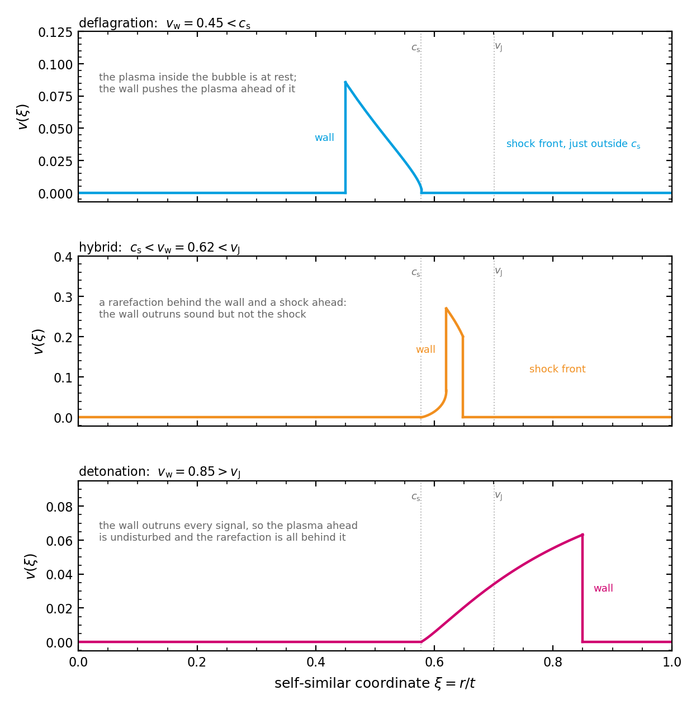

.. _algorithm-hydrodynamics:

Hydrodynamics of the bubble wall
================================

The gravitational wave signal is not produced by the scalar field directly but by the motion it
drives in the plasma. How fast the wall moves, how the fluid flows around it, and how much of
the released energy ends up as bulk motion are hydrodynamic questions, and this page is about
the equations that answer them.

The code is in
:py:mod:`transitionlistener.hydrodynamics`.

The transition strength
-----------------------

The energy released, measured against the energy already present, is

.. math::
   \alpha = \frac{\Delta\bar\theta}{3\,w_\mathrm{sym}},
   \qquad
   \bar\theta = e - \frac{p}{c_\mathrm{s,bro}^2},

where :math:`e` and :math:`p` are the energy density and the pressure, :math:`w = e + p` is
the enthalpy, :math:`w_\mathrm{sym}` its value in the symmetric phase,
:math:`c_\mathrm{s,bro}` is the sound speed of the broken phase, and :math:`\Delta` is the
difference between the symmetric and the broken phase.

:math:`\bar\theta` is the pseudo-trace anomaly of [Giese2020]_, which carries
:math:`1/c_\mathrm{s}^2` where the bag equation of state has the factor 3 in front of the
pressure. The bag trace anomaly :math:`\theta = (e-3p)/4` is the same quantity up to that
factor only for a plasma whose sound speed is :math:`1/\sqrt{3}`, and the sound speed of a
resummed potential is not that number. For a plasma of radiation the two strengths are equal,
because :math:`\bar\theta = 4\theta` and :math:`3w = 4e` there. The bag-model strength is
computed as well and reported under the key ``alpha_theta``, while ``alpha`` is the
pseudo-trace one above.

One sound speed, that of the broken phase, is used in both phases, so that everything the two
phases share cancels in the difference. One sound speed per phase would leave the radiation
bath and the zero point of the potential behind.

In the code the denominator is evaluated as
:math:`3\,c_\mathrm{s,sym}^2\,T\,\mathrm{d}e/\mathrm{d}T`, which is
:math:`3 w_\mathrm{sym}` because :math:`c_\mathrm{s}^2\,\mathrm{d}e/\mathrm{d}T
= \mathrm{d}p/\mathrm{d}T = s`, the entropy density, and :math:`w = Ts`.

Several strengths appear in a run: one evaluated at nucleation, one at the wall, and the
asymptotic ones that fix how much pressure the wall feels.

.. versionchanged:: 2.2
   Every one of those enthalpies is built from the part of the energy density that depends on
   the temperature, and not from the whole of it. The energy density is that part plus the
   vacuum energy, which is constant in temperature and cancels analytically in a difference
   and in :math:`e + p`. It does not cancel numerically. On the conformal :math:`U(1)`
   benchmark at a gauge coupling of 0.5 the vacuum energy is :math:`10^{15}` times the thermal
   part, so the difference of the whole energy density came back as exactly zero and the
   strength as infinity, and at the next coupling of that scan it kept one significant digit.
   Away from supercooling the two forms agree to every digit, so no number that was
   trustworthy moved.

.. admonition:: They must share a normalisation
   :class: important

   The efficiency with which bubble collisions radiate depends on ratios of these strengths. A
   ratio of pressures must not depend on what they are divided by, as long as all of them are
   divided by the same thing.

.. versionchanged:: 2.2
   They did not share it. The strength that drives the sound waves was normalised to the
   enthalpy of the symmetric phase, while the two describing the wall were normalised to the
   radiation energy density of the transitioning sector with zero-temperature masses. They are
   now all referred to the same enthalpy. Found and fixed by Nico Benincasa and Kristjan
   Müürsepp.

The sound speed
---------------

The speed of sound in each phase follows from the effective potential,

.. math::
   c_\mathrm{s}^2 = \frac{\partial V/\partial T}{T\,\partial^2 V/\partial T^2},

evaluated separately in the symmetric and the broken phase. It is not a constant. For a free
relativistic gas, where the free energy goes as :math:`T^4`, the expression returns
:math:`1/3`, and any term of a different power in the temperature moves it away from that
value. The cubic term of the Arnold-Espinosa resummation moves it upward, above the free-gas
value: the conformal :math:`U(1)` benchmark of :doc:`the_plots` has
:math:`c_\mathrm{s}^2 = 0.3475` in the broken phase, 4 per cent above :math:`1/3`, with a
daisy term about a third of the radiation. That is a property of the resummed potential and
not a numerical failure, and it is reported as such. It enters the matching
below, the speed at which bubbles expand, which is :math:`\max(v_\mathrm{w}, c_\mathrm{s})`, and the thickness of
the sound shell that sets the peak of the spectrum.

A value of one or more is not a speed, so nothing computed from it means anything. Such a point
is refused rather than patched, and the message names the phase and which of two known
mechanisms produced it: a loss of significant digits in the temperature derivatives, or a
resummation used outside its range.

.. versionchanged:: 2.2
   Under supercooling the sound speed returned values that depended on the differencing step,
   values above the speed of light, and at low enough temperature nothing at all. The cause lay
   in the potential rather than in the sound speed: two quantities in it are built by
   subtracting nearly equal numbers, and dividing by a second temperature derivative is where
   the lost digits become visible.

The wall velocity in local equilibrium
--------------------------------------

The wall is a surface across which the plasma flows. Conservation of the energy-momentum
tensor across it yields the junction conditions, which relate the fluid velocity and enthalpy
just ahead of the wall, :math:`v_+` and :math:`w_+`, to those just behind it, :math:`v_-` and
:math:`w_-`, both in the wall's rest frame. Eliminating the enthalpies leaves one relation
between the velocities and the strength at the wall,

.. math::
   v_+ = \frac{1}{2}\,\frac{c_\mathrm{b}^2 + v_-^2 \;\pm\; \sqrt{\mathcal{D}}}
                           {v_-\left(1 + 3 c_\mathrm{b}^2 \alpha\right)},
   \qquad
   \mathcal{D} = v_-^4 - 2c_\mathrm{b}^2 v_-^2 (1-6\alpha)
                 + c_\mathrm{b}^4\left[1 - 12 v_-^2 \alpha (1-3\alpha)\right],

with :math:`c_\mathrm{b}` the sound speed behind the wall. The two signs are the two branches,
deflagration and detonation, separated by the Jouguet velocity.

Away from the wall the fluid obeys the relativistic hydrodynamic equations for a self-similar
flow, which depend only on :math:`\xi = r/t`. Writing
:math:`\mu(\xi,v) = (\xi - v)/(1-\xi v)` for the Lorentz-transformed velocity, they reduce to
two ordinary differential equations along the velocity,

.. math::
   \frac{\mathrm{d}\xi}{\mathrm{d}v} = \frac{\xi\,(1-v\xi)}{2v\,(1-v^2)}
                     \left(\frac{\mu^2}{c_\mathrm{s}^2} - 1\right),
   \qquad
   \frac{\mathrm{d}w}{\mathrm{d}v} = w\left(1 + \frac{1}{c_\mathrm{s}^2}\right)\frac{\mu}{1-v^2},

which the code integrates outward from the wall. The first changes sign where
:math:`\mu^2 = c_\mathrm{s}^2`, and that is the sound shell at which the profile ends.

Closing the problem
~~~~~~~~~~~~~~~~~~~

The junction conditions alone do not fix the wall velocity: they hold for any
:math:`v_\mathrm{w}` and determine only how the fluid responds to it. In local thermal
equilibrium the condition that fixes it is the conservation of entropy across the wall. The
solver turns that into a shooting problem in
:math:`v_\mathrm{w}`:

1. For a trial :math:`v_\mathrm{w}`, solve for the strength at the wall consistent with the strength at
   nucleation.
2. Take :math:`v_- = \min(c_\mathrm{b}, v_\mathrm{w})` and obtain :math:`v_+` from the junction condition above.
3. Integrate the fluid equations outward from the wall to the shock front.
4. At the front the fluid must satisfy the junction condition of a shock in a medium that does
   not change phase. The residual

   .. math::
      \frac{v_+^\mathrm{sh}}{v_-^\mathrm{sh}}
      - \frac{(\mu-1)\,w_-^\mathrm{sh} + 1}{(\mu-1) + w_-^\mathrm{sh}},
      \qquad \mu = 1 + \frac{1}{c_\mathrm{s}^2},

   is what the shooting drives to zero.

A root of that residual is the wall velocity. The implementation follows [vandeVis2023]_.

   The three flow patterns, integrated with the module's own ``dfdv`` and its own shock
   condition, at one strength at the wall and three wall velocities. The panels have different
   vertical scales, because the hybrid drives the plasma about three times as hard as the
   other two.

   A wall slower than the sound speed is a **deflagration**: the plasma inside the bubble is at
   rest, the wall pushes the plasma ahead of it, and the disturbance ends at a shock front,
   which is supersonic and so sits just outside the sound speed. A wall faster than the Jouguet
   velocity is a **detonation**: it outruns every signal, so the plasma ahead is undisturbed
   and a rarefaction behind it carries the velocity back to zero exactly at the speed of sound.
   Between the two is the **hybrid**, which has both, a rarefaction behind the wall and a shock
   ahead of it. The matching behind a hybrid wall is at the sound speed, which is what makes
   its two sides different.

   The strength quoted is the one just at the wall, which is smaller than the strength at
   nucleation, because the plasma ahead has already been heated by the time the wall reaches
   it. The shooting of the previous section is what relates the two and, with them, fixes which
   of the three a given transition is.

Runaway, and no solution
~~~~~~~~~~~~~~~~~~~~~~~~

The residual has no root when the strength at nucleation exceeds the largest value admitting a
subsonic solution. The plasma then cannot hold the wall back and it runs away, and the code
returns :math:`v_\mathrm{w} = 1`. That is the expected outcome on a strongly supercooled transition,
where there is little plasma to push against, and it is not flagged as a failure.

A strength below the threshold at which any solution exists is a different statement and
returns zero, which is flagged, because every efficiency factor is proportional to the wall
velocity and the spectrum would otherwise come out as a confident prediction of silence.

.. versionchanged:: 2.2
   At percolation temperatures far below the mass scale the thermal part of the potential
   underflows in the broken phase, so its enthalpy is exactly zero and its sound speed is zero
   divided by zero. Two places downstream carried that forward instead of stopping, in both
   cases after the percolation itself had succeeded. They now stop.

.. admonition:: A limitation to be aware of
   :class: important

   The percolation history is computed with a wall velocity of one, whatever velocity is
   configured, because the velocity in local equilibrium is evaluated at the percolation
   temperature and so is not available until the history has been computed. Where the velocity
   comes out as one, which is the common case on a supercooled transition, the two agree.

The efficiency factors
----------------------

What fraction of the released energy reaches each source is given by fits to hydrodynamic
simulations [Espinosa2010]_. The sound-wave efficiency :math:`\kappa_\mathrm{sw}` is
interpolated between four limiting regimes, chosen by the wall velocity relative to the sound
speed and the Jouguet velocity, each with its own closed form in :math:`\alpha`. The
turbulent efficiency is a fixed fraction of it, set by ``epsilon_turbulence``. The
bubble-collision efficiency [EllisLewicki2019]_ depends on the ratios of the strengths
discussed above, which is why they must share a normalisation, and what is left after the
collisions have taken their share, :math:`\alpha(1-\kappa_\phi)`, is what the sound-wave fit
is evaluated at.

The fits are what the pipeline uses, including for a wall velocity obtained in local
equilibrium. The solver of the previous section computes its own efficiency on the way, by
integrating :math:`(\xi v)^2 w/(1-v^2)` over the profile it has just found, which is the
definition rather than a fit to simulations of it. That routine is ``Hydrodynamics.find_kappa``,
and nothing in the package calls it: the efficiencies that reach the spectrum come from
``calc_kappas`` and so from the fits.

The fits cover a range of strength and wall velocity. Outside it they are extrapolations
rather than results. They were also made for a plasma with :math:`c_\mathrm{s}^2 = 1/3`: the
computed sound speed is substituted into the regime boundaries and into the Jouguet velocity,
while the coefficients of the four closed forms are the ones fitted at that value.

References
----------

.. [Giese2020] F. Giese, T. Konstandin and J. van de Vis, *Model-independent energy budget of
   cosmological first-order phase transitions*, JCAP **07** (2020) 057,
   `arXiv:2004.06995 <https://arxiv.org/abs/2004.06995>`_.

.. [Espinosa2010] J. R. Espinosa, T. Konstandin, J. M. No and G. Servant, *Energy budget of
   cosmological first-order phase transitions*, JCAP **06** (2010) 028,
   `arXiv:1004.4187 <https://arxiv.org/abs/1004.4187>`_.

.. [vandeVis2023] W.-Y. Ai, B. Laurent and J. van de Vis, *The bubble wall velocity in local thermal
   equilibrium*, `arXiv:2303.10171 <https://arxiv.org/abs/2303.10171>`_.

.. [EllisLewicki2019] J. Ellis, M. Lewicki, J. M. No and V. Vaskonen, *Gravitational wave
   energy budget in strongly supercooled phase transitions*,
   `arXiv:1903.09642 <https://arxiv.org/abs/1903.09642>`_.
