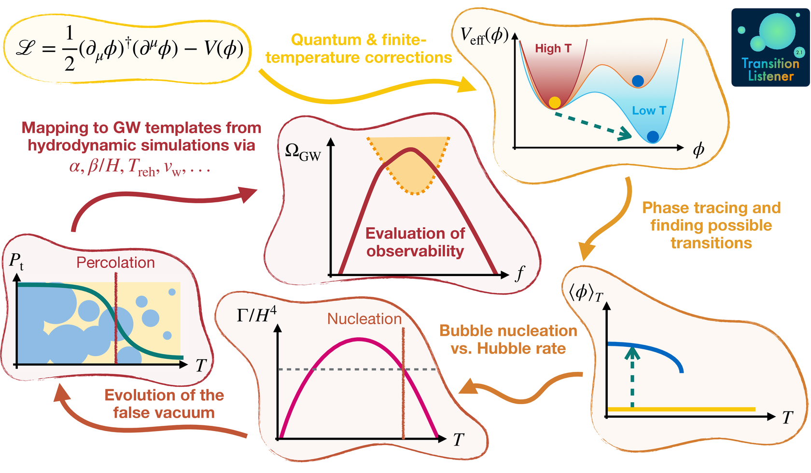

.. _implementation-notes:

Implementation notes
====================

These pages describe what TransitionListener computes at each stage of a run. Each one gives
the quantity, the equations the module solves, the choice the implementation makes where more
than one is defensible, the cases it refuses rather than guessing, the settings that reach it,
and the names of the functions that do the work.

   A run goes from a model file to an observable in six steps. A model gives an effective
   potential. The potential gives phases, and between them candidate transitions. A transition
   gives a bounce action at each temperature, and the action gives a nucleation rate, which
   integrated gives a percolation history. That history gives the transition strength and
   duration, and those give a spectrum and a signal-to-noise ratio.
   :py:mod:`~transitionlistener.interface.pipeline` coordinates the stages, and the pages
   below follow them in order.

The run from end to end
-----------------------

The starting point is a model file: the tree-level scalar potential, the field content, the
counterterms and the field-dependent mass spectrum. Models inherit from
:py:mod:`transitionlistener.generic_potential`, which evaluates the one-loop, daisy-corrected
effective potential and its derivatives from them, so a model file carries parameters rather
than machinery. :doc:`the_effective_potential` describes what is assembled and
:doc:`the_plasma` the degrees of freedom that go with it.

With the potential in hand, :py:mod:`transitionlistener.phases` follows every minimum as the
universe cools and :py:mod:`transitionlistener.transitions` reads off which pairs of them could
be connected by tunnelling. :doc:`phases_and_transitions` describes both.

For each candidate, the tunnelling path through field space is found by
:py:mod:`transitionlistener.pathDeformation` and the three-dimensional Euclidean action along
it by :py:mod:`transitionlistener.tunneling1D`. :doc:`the_bounce_action` describes the shooting
problem and the deformation loop.

The action fixes the rate at which bubbles nucleate, and
:py:mod:`transitionlistener.bubbledynamics` integrates that rate into a history of the
converted fraction, feeding the energy released back into the expansion as it goes.
:doc:`nucleation_and_percolation` describes the integral, its two solvers and the temperatures
that come out of it.

From that history :py:mod:`transitionlistener.transitionObservables` computes the quantities a
gravitational wave prediction needs, and :py:mod:`transitionlistener.hydrodynamics` the motion
the walls drive in the plasma. :doc:`the_observables` and :doc:`hydrodynamics` describe them.

Finally :py:mod:`transitionlistener.gwfopt` builds the spectrum and
:py:mod:`transitionlistener.observability` compares it with what detectors can see, which is
:doc:`the_spectrum`.

.. toctree::
   :maxdepth: 1

   the_effective_potential
   the_plasma
   phases_and_transitions
   the_bounce_action
   nucleation_and_percolation
   hydrodynamics
   the_observables
   the_spectrum
   the_plots
   error_reference
