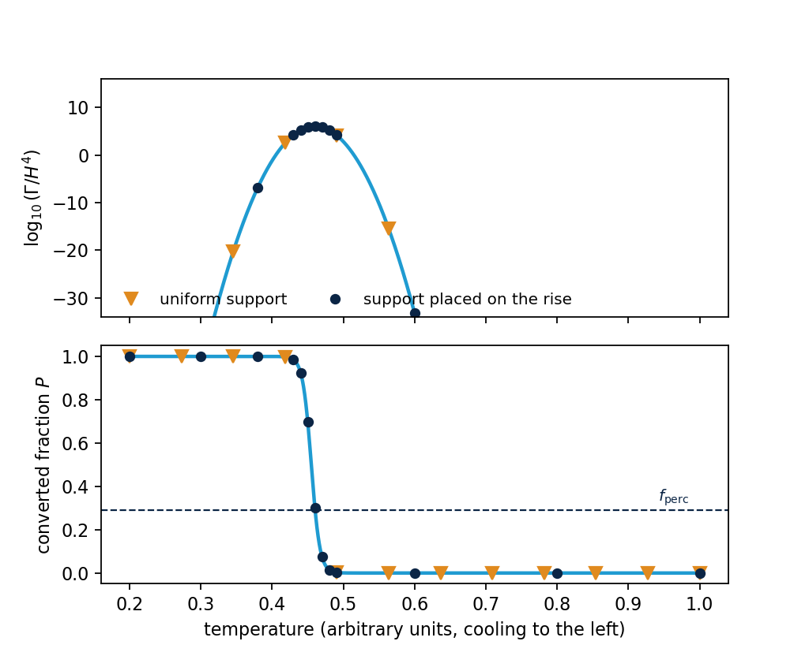

.. _algorithm-percolation:

Nucleation, percolation and the expansion history
=================================================

A transition does not happen at a temperature; it happens over a range of them. Bubbles appear
at a rate that rises steeply as the universe cools, they grow, and at some point enough of
space has converted that the transition is under way. This page describes how that history is
computed and which temperature is reported as which.

The fraction of space that has converted
----------------------------------------

The probability that a given point is still in the false vacuum at temperature :math:`T` is
:math:`\mathrm{e}^{-I(T)}`, where :math:`I` counts the bubbles whose growth has reached that point:

.. math::
   I(T) = \int_{T}^{T_\mathrm{start}} \frac{\mathrm{d}T'}{T'}\,
          \frac{\Gamma(T')}{H(T')^4}\,
          \frac{4\pi}{3}\, v_\mathrm{w}^3 \left[\int_{T}^{T'} \frac{\mathrm{d}T''}{H(T'')\,T''}\right]^3 ,

with :math:`\Gamma` the nucleation rate from :doc:`the_bounce_action`, :math:`H` the expansion
rate and :math:`v_\mathrm{w}` the speed at which a bubble wall advances. The upper limit
:math:`T_\mathrm{start}` is the hottest temperature at which the transition could have begun,
taken as the temperature at which the two phases become degenerate, above which no bubble can
nucleate. The inner integral is the
distance a bubble nucleated at :math:`T'` has grown by the time the universe has cooled to
:math:`T`, and the cube of it is its volume. The converted fraction is

.. math::
   P(T) = 1 - \mathrm{e}^{-I(T)} .

Written as it stands, the inner integral has to be redone for every value of the outer one, so
one evaluation of :math:`I` costs the square of the number of support points and a sweep over
the grid costs the cube. The same quantity is the end of a chain of four first-order equations,

.. math::
   \frac{\mathrm{d}J_0}{\mathrm{d}T} = -\frac{\Gamma}{T^4 H}, \qquad
   \frac{\mathrm{d}J_1}{\mathrm{d}T} = -\frac{J_0}{H}, \qquad
   \frac{\mathrm{d}J_2}{\mathrm{d}T} = -\frac{2 J_1}{H}, \qquad
   \frac{\mathrm{d}J_3}{\mathrm{d}T} = -\frac{3 J_2}{H},

each starting at zero at the hot end, with :math:`I = (4\pi/3)\,v_\mathrm{w}^3\,J_3`. One sweep from the
hot end to the cold one gives :math:`I` at every support point, at a cost linear in their
number, which is what makes a support of several hundred temperatures affordable. Where the
sound speed is not that of radiation the same chain carries :math:`a(T)` and
:math:`3 c_\mathrm{s}^2` explicitly; in the radiation limit they cancel.

The percolation temperature is where :math:`P` reaches a fixed fraction, conventionally about
a third, at which the bubbles form a connected network [GuthWeinberg1981]_. The nucleation temperature, the more
familiar quantity, is where roughly one bubble exists per Hubble volume [Enqvist1992]_
[Turner1992]_. Neither is a property
of the potential alone: both depend on the expansion rate, which in turn depends on how much of
the universe has already converted.

Three passes
------------

That circularity is handled by computing the history three times, each with a better expansion
rate.

**The first pass** locates the temperature range in which anything happens at all, so that the
later passes do not spend bounce actions far away from it. Actions are expensive and this is
what makes the cost bearable.

**The second pass** computes :math:`P(T)` using the expansion rate of a universe that has not
yet converted. This neglects the energy the transition releases.

**The third pass** feeds the converted fraction back into the expansion rate and into the
temperature of the phase the bubbles grow into, which is heated by the energy released. It is
iterated to consistency, and it is the one that gives the reheating temperature and decides
whether the transition completes.

Two backends
------------

The history above can be computed by either of two solvers, chosen with
``percolation_algorithm_mode``. They differ in one thing: how the temperatures at which an
action is evaluated are chosen. That choice is the whole cost of a run and most of its
accuracy.

.. list-table::
   :header-rows: 1
   :widths: 22 39 39

   * -
     - ``fixed_step_size``
     - ``adaptive_step_size`` (default)
   * - Support
     - A fixed number of temperatures, evenly spaced over the current range.
     - A budget of temperatures, placed where the profile is not yet resolved.
   * - When it refines
     - By moving or rescaling the whole grid and recomputing it.
     - By adding points inside the intervals that need them, keeping what is computed.
   * - Cost
     - Known in advance: ``n_action`` actions per range it tries.
     - Bounded by the budget; a temperature whose action is cached is free.
   * - Strength
     - Simple, predictable, and adequate when the transition is not supercooled.
     - Resolves a rise that occupies a small fraction of the range.
   * - Weakness
     - A rise narrower than the spacing is stepped over, and widening the range makes that
       worse.
     - More machinery, and its refinement decisions are harder to follow.

Both share the thermodynamics: the rate, the integral, the energy densities and the expansion
history come from the same routines, so a difference between the two backends is a difference
in sampling and not in physics.

The fixed-step backend
----------------------

It lays ``n_action`` temperatures evenly across a trial range and computes the profile on them.
If the result is unusable it changes the range rather than the sampling: it moves the window
when the transition sits outside it, narrows it around a jump in the converted fraction when
one is found, and tries again with the same number of points. The grid is always uniform and
always the same size, so the cost of each attempt is known before it starts.

This is adequate when the rise of the rate occupies a decent fraction of the temperature range,
which is the ordinary case. It fails when the rise is narrow compared with the range, because
then a uniform grid steps over it: the profile comes back as a jump from zero converted to
fully converted between two neighbouring points, and the percolation temperature is read off a
curve that was never resolved.

The adaptive backend
--------------------

Its internal name is the dynamic zoom window, which is what the ``_dynamiczoomwindow_``
functions in the source refer to. It treats the number of actions as a budget and spends it
where the profile needs it.

   The rate in Hubble units is appreciable over a short interval and negligible elsewhere. A
   grid spread evenly over the temperature range steps across the rise and sees the converted
   fraction jump from zero to one with nothing in between.

Scouting
~~~~~~~~

The first pass works on :math:`\log_{10}(\Gamma/H^4)` rather than on the converted fraction,
because that is the quantity whose shape matters and it is well behaved over the whole range.
It computes a sparse set of actions, reconstructs an approximate profile, and asks two
questions: whether the hot end is far enough out that nucleation has not begun, and whether the
cold end is far enough down that it can no longer contribute. The second has a quantitative
answer: once the rate has fallen a thousand decades below its peak no colder point can change
the converted fraction, and the tail below that is dead.

If either end fails the window is widened and more actions are spent, up to a ceiling. When the
transition is bracketed the interior peak of the rate is located and a window is built around
it, and that window is the starting grid for the next pass.

Refinement
~~~~~~~~~~

Several strategies exist because there are several ways for a profile to be unresolved, and
each has its own signature:

**A jump in the converted fraction.** Two neighbouring support points differing by more than
:math:`\Delta P = 0.1` means the rise between them is unresolved, and intermediate
temperatures are added. This is the commonest case and the most direct statement that the grid
has stepped over the transition.

**The rise of the rate.** Points are added across the interval where
:math:`\log(\Gamma/H^4)` climbs, located from the sampled rate rather than from the converted
fraction, so that the rise is resolved before it has had any visible effect on :math:`P`.

**The peak of the rate**, refined where the sampled maximum is a single point rather than a
resolved shape.

**The hot shoulder**, where the converted fraction is still near zero but the rate is already
appreciable, so the integral is accumulating in a region the grid treats as empty.

**The hot head**, the hottest retained support point, which has to sit where nothing has
happened yet. If the profile still rises there, the window did not start early enough.

**Remeshing from anchors**, placing a fresh batch at fixed values of :math:`P` rather than
adding to the existing grid, which distributes effort by how much of the transition each
interval carries.

**Extending the range** in small batches, with the cold boundary chosen from how much the last
extension gained.

Acceptance
~~~~~~~~~~

A profile is accepted only if no two neighbouring support points differ by more than
:math:`\Delta P = 0.2`, and the hot head is resolved. An interval is exempt from the first
test where the rate there is so far past its peak that it cannot contribute, which is the same
dead-tail criterion the scout uses.

If neither the refinement budget nor the range can fix a failure, the point is refused, and the
message says which resource ran out: the number of actions, the number of iterations, or the
temperature range.

.. versionchanged:: 2.2
   The refinement strategies above, the acceptance tests, and the distinction between running
   out of budget and a transition that genuinely does not percolate are new. Before, the solver
   could exhaust its budget on the couplings nearest the percolation edge and report that in a
   way indistinguishable from a physical verdict.

Settings
~~~~~~~~

.. list-table::
   :header-rows: 1
   :widths: 34 10 56

   * - Setting
     - Default
     - Meaning
   * - ``percolation_algorithm_mode``
     - adaptive
     - Which backend computes the history.
   * - ``n_action``
     - 30
     - Support points of the fixed-step backend.
   * - ``n_action_min``
     - 15
     - Support points built before the first adaptive refinement sweep.
   * - ``n_action_increment``
     - 5
     - Support points added per adaptive refinement iteration.
   * - ``n_action_max``
     - 60
     - Most new support points in one update; a cached action is free.
   * - ``max_action_temperatures``
     - 100
     - Most actions the scout may spend bracketing the transition.
   * - ``large_delta_p_refine_threshold``
     - 0.1
     - Neighbouring jump in :math:`P` above which refinement is triggered.
   * - ``large_delta_p_success_threshold``
     - 0.2
     - Neighbouring jump in :math:`P` above which a profile is refused.
   * - ``percolation_maxit``
     - 20
     - Refinement iterations before the solver gives up.
   * - ``f_perc``
     - 0.28957
     - Converted fraction defining the percolation temperature.
   * - ``max_boundary_ratio``
     - 0.45
     - Most of the range that may sit on a plateau where :math:`P` is zero or one.

The expansion history
---------------------

The scale factor is needed in two places: in the growth of a bubble, and in the dilution of the
energy density. It follows from entropy conservation, :math:`a^3 s = \mathrm{constant}`, where
:math:`s` is the entropy density of the phase being traced.

.. versionchanged:: 2.2
   The scale factor comes from entropy conservation rather than from integrating
   :math:`\mathrm{d}\ln a/\mathrm{d}T = -1/(3 c_\mathrm{s}^2 T)` across a grid that can span ten or more decades of
   temperature. The entropy and the sound speed used anywhere in the history are now the same
   one, selected by a single setting, rather than one coming from the counted degrees of
   freedom and the other from the effective potential.

The entropy used
~~~~~~~~~~~~~~~~

The entropy can be taken in two ways, selected by ``entropy_definition``. ``dof_table``, the
default, uses the counted degrees of freedom; ``eff_potential`` uses :math:`-\partial V/\partial T`
of the effective potential. They are two forms of the same quantity and agree where the
counting and the potential describe the same plasma. The important thing is that one of them is
used throughout: the scale factor and the sound speed must come from the same entropy, or the
expansion history is not consistent with the thermodynamics it is built from.

The temperatures reported
-------------------------

``Tcrit``
   Where the two minima are degenerate. A property of the potential alone.

``Tnuc``
   Where about one bubble has nucleated per Hubble volume.

``Tperc``
   Where the converted fraction reaches the percolation threshold.

``Tf``
   Where the transition completes, in the sense that the false-vacuum fraction has fallen to a
   small final value.

``Treh``
   The temperature after the released energy has been shared out.

Completion
----------

Percolating is not the same as finishing. The false vacuum occupies a physical volume
:math:`\mathcal{V} \propto a^3 \mathrm{e}^{-I}`, which has two competing factors: the expansion inflates
it and the growth of the bubbles eats it. The transition finishes only where the second wins,

.. math::
   \frac{1}{\mathcal{V}}\frac{\mathrm{d}\mathcal{V}}{\mathrm{d}t}
   = 3H\left(1 + c_\mathrm{s}^2\, T\,\frac{\mathrm{d}I}{\mathrm{d}T}\right) < 0 ,

which is the criterion of [Turner1992]_ in the form of [EllisLewickiNo2018]_, written for the
time-temperature relation :math:`\mathrm{d}T/\mathrm{d}t = -3 c_\mathrm{s}^2 H T` rather than the radiation one. A
transition that percolates but never satisfies this is reported as stalled, not as complete.

The mean separation between bubbles
-----------------------------------

The number density of bubbles that have nucleated by temperature :math:`T`, each diluted by the
expansion since it appeared, is

.. math::
   n_\mathrm{b}(T) = \int_T^{T_\mathrm{start}} \frac{\mathrm{d}T'}{T'}\,\frac{\Gamma(T')}{H(T')}\,
            \mathrm{e}^{-I(T')} \left[\frac{a(T')}{a(T)}\right]^3 ,

and the mean separation is :math:`R_* = n_\mathrm{b}^{-1/3}`. The factor :math:`\mathrm{e}^{-I}` is there because
a bubble can only nucleate in space that is still in the false vacuum. :math:`R_*` is what sets
the frequency at which the spectrum peaks, and it is the quantity the second of the two inverse
durations below is read from.

The reheating temperature
-------------------------

The phase the bubbles grow into is heated by the energy the transition releases, so it is not at
the temperature of the phase they nucleate in. Its temperature follows from an entropy-conserving
step plus an energy correction for the fraction converted during that step, which is a
discretisation of

.. math::
   \frac{\mathrm{d}T_\mathrm{b}}{\mathrm{d}T} = \frac{3\,S(T_\mathrm{b})}{T\,S'(T_\mathrm{b})}
   + \frac{P'(T)}{P(T)}\,\frac{e_\mathrm{s}(T) - E(T_\mathrm{b})}{E'(T_\mathrm{b})} ,

with :math:`S` and :math:`E` the entropy and energy density of the broken phase and
:math:`e_\mathrm{s}` the energy density of the symmetric one. The first term is the cooling the
expansion alone would give; the second is the heating.

.. versionchanged:: 2.2
   The equation is integrated with an error-controlled integrator rather than read off the
   tabulated trajectory. Read off the table, the reheating temperature depends on where the
   support points happen to sit, which shows up as point-to-point scatter along scans that are
   otherwise smooth.

The inverse duration
--------------------

How fast the transition proceeds is quoted as :math:`\beta/H`, and there are two of them,
which answer different questions.

The first is local: the logarithmic derivative of the rate at the percolation temperature,
:math:`\beta/H = T\,d(S_3/T)/\mathrm{d}T`. The second is integral: it is read off the mean separation
between bubbles, :math:`R_*`, which follows from the whole nucleation history rather than from
one temperature.

The two agree when the transition is fast, because then the rate is well described by its
slope at one point. They do not agree when it is slow, and the difference is physical rather
than numerical. A feature in one of them is not evidence of anything until it appears in the
other.

.. versionchanged:: 2.2
   The mean bubble separation is obtained from the expansion history rather than from a
   relation that assumes radiation domination, and the local derivative is obtained from a fit
   to the action rather than from a two-point difference.

Refusals
--------

- The converted fraction never reaches the percolation threshold, so there is no percolation
  temperature on the range searched.
- The transition percolates and then stalls, never reaching completion. This is reported
  separately from the previous case, because the physics differs: a transition that stalls
  leaves a mixture of phases.
- The estimate that brackets the percolation temperature does not converge.
- The sampled action implies a rate that is not smooth, which means the action itself is not
  resolved.
- The run exceeded its time limit. This is a statement about the clock and not about the
  physics, and it is reported as its own failure rather than as a verdict.

In the code
-----------

``bubbledynamics.calcPercAndEvolve`` is the entry point and ``percIntegral`` the integral
itself. The adaptive solver lives in ``percolation_adaptivestepsize`` for the controllers and
the state, ``percolation_adaptive_gridbuilders`` for turning arrays into the next set of
candidate temperatures, and ``percolation_adaptive_rate`` for locating the rise of the rate. A
fixed-step solver exists alongside it in the modules ending ``_fixedstep``.

References
----------

.. [GuthWeinberg1981] A. H. Guth and E. J. Weinberg, *Cosmological consequences of a first
   order phase transition in the SU(5) grand unified model*, Phys. Rev. D **23** (1981) 876.
   The percolation criterion.

.. [Enqvist1992] K. Enqvist, J. Ignatius, K. Kajantie and K. Rummukainen, *Nucleation and
   bubble growth in a first order cosmological electroweak phase transition*,
   Phys. Rev. D **45** (1992) 3415.

.. [Turner1992] M. S. Turner, E. J. Weinberg and L. M. Widrow, *Bubble nucleation in first
   order inflation and other cosmological phase transitions*, Phys. Rev. D **46** (1992) 2384.

.. [EllisLewickiNo2018] J. Ellis, M. Lewicki and J. M. No, *On the maximal strength of a
   first-order electroweak phase transition and its gravitational wave signal*, JCAP **04**
   (2019) 003, `arXiv:1809.08242 <https://arxiv.org/abs/1809.08242>`_.
