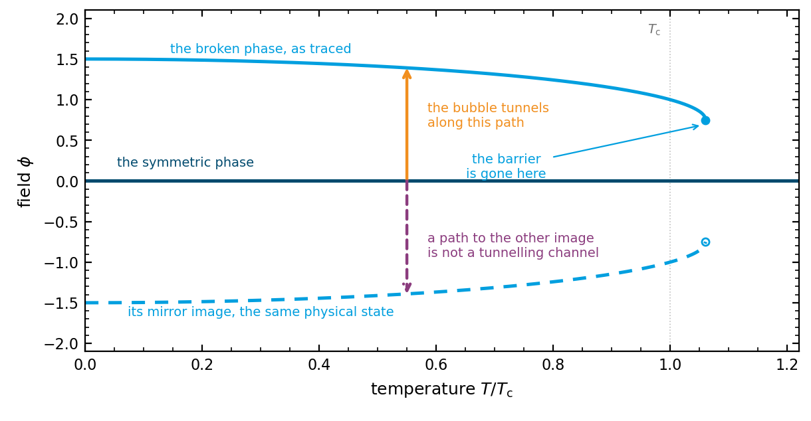

.. _algorithm-phases:

Phases and transitions
======================

A phase is a minimum of the effective potential followed as a function of temperature. A
transition is the passage from one phase to another. Before any bounce can be computed the code
has to know which minima exist, over which temperature ranges, and which pairs of them are
candidates for a transition.

The tracing is in :py:mod:`transitionlistener.phases` and the pairing in
:py:mod:`transitionlistener.transitions`.

Tracing a minimum
-----------------

Starting from a minimum at one temperature, the field value at a neighbouring temperature is
obtained from the condition that the gradient of the potential stays zero. Differentiating

.. math::
   \left.\nabla V\right|_{\phi = \phi_{\min}(T)} = 0

with respect to temperature yields

.. math::
   \frac{\mathrm{d}\phi_{\min}}{\mathrm{d}T}
   = - \left(\frac{\partial^2 V}{\partial\phi_i\,\partial\phi_j}\right)^{-1}
       \frac{\partial}{\partial T}\frac{\partial V}{\partial\phi_j},

so the minimum is followed by integrating this [WainwrightPhases]_, with a Newton step at each temperature to
remove the error that accumulates. The step in temperature is chosen from the change in the
field it produces, so that the tracer takes small steps where the minimum moves quickly and
large ones where it does not.

A trace ends when the minimum stops being one. That happens when it meets another minimum and
the barrier between them disappears, when the second derivative of the potential along some
direction reaches zero so that the minimum turns into a saddle, or when the temperature range
asked for is exhausted.

.. versionchanged:: 2.2
   The tracer stops where the point it carries is no longer a minimum. The test for a saddle
   was not applied along the direction in which the minimum was actually being lost, so a trace
   could continue past the point where the phase ceases to exist and report field values that
   are not minima of anything.

   The traced points are also interpolated in a way that cannot leave the range of the trace
   itself, so that a phase is not reported at field values it was never traced through.

Symmetries and images
---------------------

Where the potential is invariant under a discrete symmetry group, such as the reflection
:math:`\phi \to -\phi`, a minimum is not one point but a set of images of the same physical
state. Which image a trace ends up on is decided by the sign of a numerical
step and carries no physical meaning.

   A potential even in the field has two images of every broken minimum, and which one a trace
   lands on is settled by the sign of a numerical step. A bounce computed from the symmetric
   phase to the image the field does not occupy is not a tunnelling channel.

The broken branch is drawn for a first-order transition, so it reaches the critical temperature
at a field value well away from zero, survives above it while the symmetric phase is still the
deeper one, and ends where the barrier between the two disappears.

This matters because a bounce is computed between two phases. If the two sit on different
images, the path between them crosses field space from one copy of the vacuum to another copy
of the other, which is not a tunnelling channel, and the action computed along it is not the
action of the transition. Nothing downstream can detect it: the number is finite and looks
ordinary.

The remedy is to put each traced phase on a canonical image as a whole, rather than point by
point, so that the pairing handed to the bounce solver is the physical one.

.. versionchanged:: 2.2
   A whole traced phase is put on its canonical image, chosen from the potential rather than
   from the order in which points were traced. Phases that are their own mirror image are
   placed on the fixed subspace of the symmetry, where they belong.

   The solver can additionally be offered every image of the false vacuum and keep the smallest
   action, but this is off by default: once the phases themselves are on their canonical
   images the pairing is already right, and the extra bounces cost time without changing the
   answer.

Candidate transitions
---------------------

With the phases traced, the code walks down in temperature and builds the chain of phases the
universe occupies. At each step it asks which phases coexist, whether the one being occupied is
still the deepest, and which other phase it could go to. A pair that coexists over a range of
temperature, with the destination deeper than the origin and a barrier between them, is a
candidate for a first-order transition. Where the two minima merge continuously instead, the
step is second order and no bounce is computed.

Refusals
--------

- No phases at all, or only one, so there is no pair to tunnel between.
- No viable pair below the phase the walk has reached, so nothing about a rate was computed at
  that step. This is a different statement from a transition that was attempted and failed to
  nucleate, and it carries its own error code.
- A chain that does not end in the expected zero-temperature minimum.

.. versionchanged:: 2.2
   The distinction in the second point is new. Previously, a step where no candidate was ever
   offered to the nucleation solver and a step where a candidate was offered and the solve did
   not succeed were reported the same way, so a scan could not tell a numerical failure from a
   transition that genuinely does not proceed.

References
----------

.. [WainwrightPhases] C. L. Wainwright, *CosmoTransitions: computing cosmological phase
   transition temperatures and bubble profiles with multiple fields*,
   Comput. Phys. Commun. **183** (2012) 2006, `arXiv:1109.4189
   <https://arxiv.org/abs/1109.4189>`_. The tracing and transition-finding scheme this
   implementation extends.
