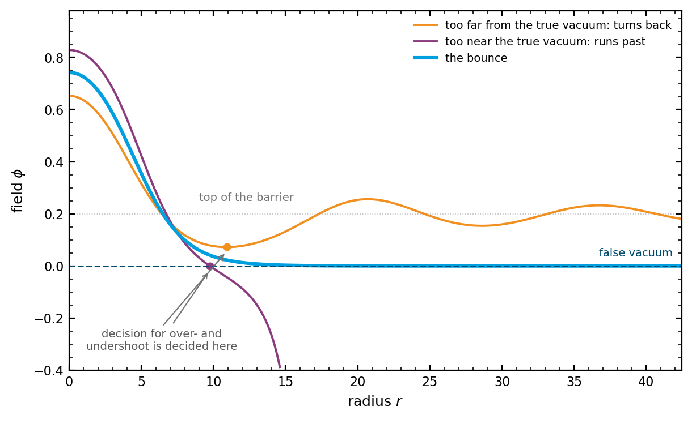

.. _algorithm-bounce:

The bounce action
=================

A first-order transition proceeds by bubbles of the true vacuum appearing in the false one.
The probability per unit volume and time for a bubble to appear is set by the action of a
field configuration that interpolates between the two vacua, and computing that action is the
most expensive thing TransitionListener does. Everything downstream, the nucleation
temperature, the percolation temperature, the inverse duration of the transition and the
spectrum, rests on it.

The quantity
------------

At a temperature :math:`T` the relevant configuration is the three-dimensional bounce, a
static solution that is symmetric under rotations in space. It satisfies

.. math::
   \frac{d^2\phi}{\mathrm{d}r^2} + \frac{2}{r}\frac{\mathrm{d}\phi}{\mathrm{d}r} = \frac{\partial V}{\partial\phi},

with :math:`\phi \to \phi_\mathrm{false}` as :math:`r \to \infty` and :math:`\mathrm{d}\phi/\mathrm{d}r = 0` at the
origin, where :math:`r` is the distance from the centre of the bubble and :math:`V` is the
effective potential at that temperature. The second term is a friction term whose coefficient
is the number of spatial dimensions minus one. Its action is

.. math::
   S_3 = \int_0^\infty \left[ \frac{1}{2}\left(\frac{\mathrm{d}\phi}{\mathrm{d}r}\right)^2
         + V(\phi) - V(\phi_\mathrm{false}) \right] 4\pi r^2 \, \mathrm{d}r ,

and the rate per unit volume follows as

.. math::
   \Gamma(T) = T^4 \left(\frac{S_3}{2\pi T}\right)^{3/2} \mathrm{e}^{-S_3/T}.

The exponent :math:`S_3/T` is what matters: it runs over tens of orders of magnitude across
the temperatures of a transition, so the rate is set by the action and the prefactor only
shades it.

.. admonition:: Only the thermal bounce is computed
   :class: important

   The zero-temperature bounce, which is symmetric in four dimensions and has action
   :math:`S_4`, is not evaluated, and the two are not compared. At low enough temperature
   :math:`S_4` can be the smaller exponent and the one that governs the rate. Transitions that
   supercool far enough for that to matter are outside what this version computes.

Finding the bounce
------------------

Along one direction in field space, by shooting, which is the method of
[Coleman1977]_ as implemented numerically by [Wainwright2011]_.

The idea is that the equation above is a boundary-value problem, and it is turned into a
sequence of initial-value problems. Pick a field value at the centre of the bubble, integrate
outward, and see what happens. Start too close to the true vacuum and the field has too little
energy: friction stops it before it reaches the false vacuum, and it falls back. Start too far
and it arrives with energy to spare and shoots past. The solution lies between the two, and
bisecting on the starting value finds it.

   One bisection step. A start too far from the true vacuum leaves the field without the energy
   to reach the false one, and friction turns it back. A start too near it arrives with energy
   to spare and passes through. The solution lies between the two.

The two markers are where over- and undershoot is decided and the shooting stops. Carried past
that point, which is what the figure does, the undershoot oscillates about the top of the
barrier, damped by the friction term, and the overshoot crosses the false vacuum and runs
away.

Three details make this work in practice.

**The integration cannot start at the centre**, because the friction term diverges at
:math:`r = 0`.
Near the centre the field barely moves, so the potential there is well approximated by a
quadratic, and for a quadratic the equation has a closed-form solution in terms of Bessel
functions. That solution carries the field from the origin out to a small radius, and the
numerical integration takes over from there. The same closed form is used afterwards to fill
the interior back in, so the profile that the action is computed from does start at
:math:`r = 0`.

**The starting value is parametrised logarithmically**, writing the field at the centre as

.. math::
   \phi(0) = \phi_\mathrm{true} + \mathrm{e}^{-x}\,(\phi_\mathrm{false} - \phi_\mathrm{true}),

where :math:`\phi_\mathrm{true}` and :math:`\phi_\mathrm{false}` are the field values of the
two minima at this temperature,

the solver bisects on :math:`x` rather than on the field directly. A thin-walled bubble, which
appears when the two minima are nearly degenerate, starts exponentially close to the true
vacuum, and :math:`x` resolves that as easily as it resolves a thick-walled one.

**A trial ends in one of three ways**: the field turns around before reaching the false vacuum,
which is an undershoot and means the starting value was too close to the true vacuum. It passes
the false vacuum, which is an overshoot. Or it arrives: the field and its derivative both land
within a small distance of the false vacuum at rest, and the trial has converged.

.. versionchanged:: 2.2
   Both tolerances in the paragraphs above are now measured against the bounce rather than
   against the distance between the two minima. The distance between the minima is a property
   of the potential; the width of the barrier is set by the temperature, and on a strongly
   supercooled transition the two differ by orders of magnitude.

In several field directions
---------------------------

With more than one scalar the bubble is still a function of one radius, but the field traces a
curve through field space, and that curve is not known in advance. The solution is the method
of [Wainwright2011]_: guess a path, solve the one-dimensional problem along it, then
move the path so that it becomes a solution of the full equations, and repeat.

What "move the path" means is fixed by the part of the equation of motion that the
one-dimensional problem leaves out. Along the path the field obeys the equation above with
:math:`V` replaced by the potential restricted to the path. Across it, the field must satisfy

.. math::
   \left(\frac{\mathrm{d}\phi}{\mathrm{d}r}\right)^2 \frac{d^2\phi}{\mathrm{d}s^2}
   = \left. \nabla V \right|_\perp ,

where :math:`s` is the distance along the path and :math:`\perp` denotes the component of the
gradient normal to it. The left side is the acceleration the path forces on a field moving
along it at the speed the one-dimensional solution gives; the right side is the push the
potential provides. Where they differ, the path is not a solution, and the difference is a
normal force that tells each point of the path which way to move. The path is deformed along
that force until it vanishes.

Convergence is measured by the largest normal force anywhere on the path divided by the largest
gradient of the potential along it. When that ratio falls below its tolerance the path is a
solution of the full equations to that accuracy, and the action along it is the answer.

.. versionchanged:: 2.2
   The path solver's length scales are also measured against the barrier rather than against
   the distance between the minima, and the potential along the path is sampled where the
   barrier is rather than uniformly, in the cases where a uniform grid does not resolve it. On
   the classically conformal model shipped with the package this moves the weakest transition
   that can be computed at all to a considerably weaker coupling.

   Where the deformation stops improving while still above its tolerance, the spline basis
   describing the path is refined and the deformation continues, rather than the path being
   accepted as it stands.

Refusals
--------

A bounce action that comes back as a number is a claim about the physics, so the solver refuses
rather than returns one in each of these cases:

- The potential is not metastable: the false vacuum is not higher than the true one, and there
  is nothing to tunnel from.
- There is no barrier between the two minima, so the transition is not first order and there is
  no bounce to find.
- The integration cannot proceed, either because the step has fallen below its floor or because
  the radius has run past its ceiling.
- The action is not finite and positive. The Euclidean action of a bounce is both.
- The two trials that bracket the solution disagree about the action by more than a few per
  cent. The bisection can terminate on its tolerance while the bounce itself is unresolved, and
  the disagreement between the last undershoot and the last overshoot is what shows it.

.. versionchanged:: 2.2
   The last two refusals are new. Before, an action of zero or infinity and an unresolved
   bracket were all returned as numbers, and nothing downstream could tell them from a
   resolved result. A negative action in particular was replaced by zero further on and the
   point labelled a second-order transition, so a failure of the solver arrived as a statement
   about the physics.

Settings
--------

.. list-table::
   :header-rows: 1
   :widths: 26 14 60

   * - Setting
     - Default
     - What it controls
   * - ``phitol``
     - 1e-10
     - Tolerance of the profile integration, as a fraction of the field excursion of the
       bounce. It also sets the distance inside which a trial counts as having reached the
       false vacuum, at three times that fraction.
   * - ``xtol``
     - 1e-10
     - Width at which the shooting bracket is narrow enough, as a fraction of the starting
       value it brackets.
   * - ``phi_eps``
     - 1e-6
     - Offset used for the numerical derivatives of the potential and for the expansion about
       the true vacuum.
   * - ``fRatioConv``
     - 2e-2
     - Convergence of the path deformation, as the largest normal force divided by the largest
       gradient. Tightened to 1e-2 where the model has more than one field.
   * - ``converge_0``
     - 5.0
     - The same ratio, applied as an early stop during the first stage of the deformation.
   * - ``V_spline_samples``
     - 1000
     - Points at which the potential is sampled along the path.

The precision modes ``robust``, ``xtrace``, ``tunneltight`` and ``benchmark`` set several of
these together; see :doc:`../usage`.

In the code
-----------

``tunneling1D.SingleFieldInstanton`` solves the one-dimensional problem: ``findProfile`` shoots
and bisects, ``integrateProfile`` carries one trial outward and classifies it, ``findAction``
integrates the result. ``pathDeformation.fullTunneling`` runs the loop over paths, with
``Deformation_Spline`` providing the normal force and the step, and ``SplinePath`` representing
the path and the potential along it. ``pathDeformation.bounceAction`` is the entry point the
rest of the package calls.

References
----------

.. [Coleman1977] S. Coleman, *Fate of the false vacuum: semiclassical theory*,
   Phys. Rev. D **15** (1977) 2929; C. G. Callan and S. Coleman,
   *Fate of the false vacuum II: first quantum corrections*, Phys. Rev. D **16** (1977) 1762.
   The thermal, three-dimensional case is due to A. D. Linde, *Decay of the false vacuum at
   finite temperature*, Nucl. Phys. B **216** (1983) 421.

.. [Wainwright2011] C. L. Wainwright, *CosmoTransitions: computing cosmological phase
   transition temperatures and bubble profiles with multiple fields*,
   Comput. Phys. Commun. **183** (2012) 2006, `arXiv:1109.4189
   <https://arxiv.org/abs/1109.4189>`_. TransitionListener's bounce solver extends this one.
