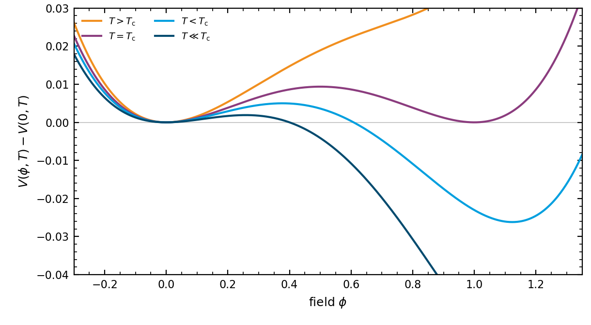
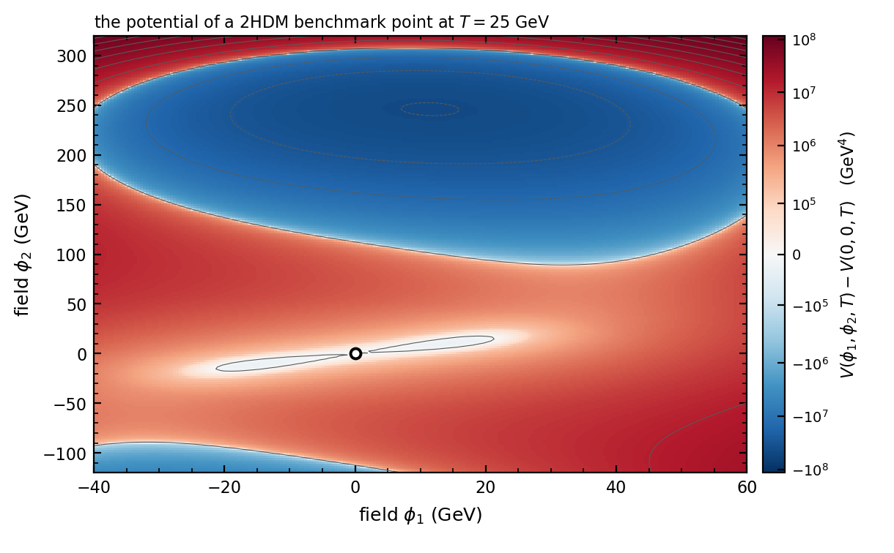

.. _algorithm-potential:

The effective potential
=======================

Everything a run computes follows from one function: the free energy of the scalar fields at a
given temperature, written below as the effective potential :math:`V(\phi, T)`. The phases are
its minima. A transition is the passage from one minimum to another. The bounce is a solution
of the equations of motion of the scalar fields in this potential, and the energy the
transition releases is the difference between the values of the potential at the two minima.
The model file specifies the tree-level potential and the field-dependent mass spectrum. This
page describes the loop, thermal and resummed terms that the package adds to them.

Assembling the potential
------------------------

The effective potential is assembled as

.. math::
   V(\phi, T) = V_0(\phi) + V_1(\phi) + V_\mathrm{ct}(\phi) + V_\mathrm{T}(\phi, T)
                + V_\mathrm{daisy}(\phi, T) + V_\mathrm{rad}(T),

where :math:`V_0` is the tree-level potential from the model, :math:`V_1` the one-loop
correction at zero temperature, :math:`V_\mathrm{ct}` the counterterms that hold the tree-level
vacuum and masses in place, :math:`V_\mathrm{T}` the one-loop thermal correction,
:math:`V_\mathrm{daisy}` the resummation of the infrared-sensitive modes, and
:math:`V_\mathrm{rad}` the field-independent radiation, which does not move the minima but does
set the energy density and so the expansion rate.

The one-loop correction at zero temperature [ColemanWeinberg1973]_, in the modified minimal
subtraction scheme, is

.. math::
   V_1 = \frac{1}{64\pi^2}\left[ \sum_{i \in \mathrm{bosons}} n_i\, m_i^4
         \left( \ln\frac{|m_i^2|}{\mu^2} - c_i \right)
         - \sum_{f \in \mathrm{fermions}} n_f\, m_f^4
         \left( \ln\frac{|m_f^2|}{\mu^2} - \frac{3}{2} \right) \right],

with :math:`n` the number of degrees of freedom of each species, :math:`m^2(\phi)` its
field-dependent mass squared, and :math:`\mu` the renormalisation scale. The constant
:math:`c_i` comes with the renormalisation scheme: in the modified minimal subtraction scheme
it is :math:`3/2` for the scalars, the Goldstone modes and the fermions, and :math:`5/6` for
the gauge bosons, counting their three polarisations together in the Landau gauge. Each
species carries its own value, set in the mass spectrum of the model. The thermal part is
the standard one-loop integral [DolanJackiw1974]_, evaluated from splined forms of the bosonic and fermionic
thermal functions, which take the mass over temperature squared as their argument so that a
negative mass squared can be handled as the real part of the defining integral.

Counterterms
------------

The one-loop correction shifts the minimum of the tree-level potential and the masses at it.
The counterterms undo that, so that the parameters a user supplies remain the physical vacuum
expectation value and the physical masses rather than tree-level inputs that happen to be near
them. They are fixed by requiring that the first and second derivatives of
:math:`V_1 + V_\mathrm{ct}` vanish at the zero-temperature vacuum.

.. versionchanged:: 2.2
   The derivatives that fix the counterterms used to take their step from the tolerance of the
   phase tracer, so tightening an unrelated accuracy setting changed the potential itself. They
   now take their own step, whose default is the value that was in effect in the default setup.

   The effective potential of a benchmark model in dependence of temperature. Well above the
   critical temperature the only minimum is the symmetric one. A second minimum appears, the
   two are degenerate at :math:`T_\mathrm{c}`, and below that the broken minimum is the deeper
   of the two with a barrier still between them.

The barrier is what makes the transition first order. The bounce of :doc:`the_bounce_action`
is the field configuration that carries the field over it, not through it: at finite
temperature the field is lifted over the barrier by a thermal fluctuation rather than
tunnelling under it.

A model with more than one scalar field has a potential over a plane, and the same two minima
are then separated by a ridge rather than by a point. The next figure is the same potential in
its two field directions, at a temperature at which the origin has already stopped being a
minimum.

   The same potential in both of its field directions, at a temperature where the origin is a
   saddle rather than a minimum: the curvature there has one negative eigenvalue, so the field
   can roll away from the open circle along one direction and not along the other. The deep
   region at the top is the broken minimum. The colour scale is symmetric and logarithmic
   about the value at the origin.

Resummation of the infrared modes
---------------------------------

At high temperature the loop expansion is no longer ordered by the coupling alone. Every
bosonic field has a Matsubara zero mode, whose propagator carries no factor of
:math:`\pi T` to suppress it, and inserting one more self-energy into a loop of that mode
contributes a factor :math:`g^2T^2/m^2` to it rather than :math:`g^2`. Where the field-dependent mass
:math:`m` is of the order of the self-energy itself, which is the Debye mass of order
:math:`gT`, that factor is of order one: the chain of daisy diagrams contributes at the same
order, :math:`g^3T^4`, as the cubic term the one-loop thermal integral produces, and
truncating at one loop keeps only part of a contribution. The remedy is to resum the
self-energies into the masses of the modes that are infrared sensitive, which are the
longitudinal modes of the gauge bosons, whose Debye mass is of order :math:`gT`, and the
scalars. The transverse gauge modes have no Debye mass and are not resummed. Two prescriptions
are offered, selected per model:

.. list-table::
   :header-rows: 1
   :widths: 22 78

   * - Setting
     - What it does
   * - ``ArnoldEspinosa``
     - The resummation is added as a separate cubic potential term, built from the difference
       between the thermally corrected and the uncorrected masses, and applied to the
       longitudinal modes [ArnoldEspinosa1993]_.
   * - ``Parwani``
     - The thermal masses are substituted into the one-loop thermal integral directly, so that
       all modes are resummed [Parwani1992]_.
   * - ``off``
     - No resummation, which is correct only where no mode is light against the temperature.

Neither prescription is uniformly better, and they differ by terms of the order that is being
resummed. Where a result depends on which is chosen, that dependence is an uncertainty of the
calculation and not a detail of the implementation.

.. admonition:: Where the resummation stops being valid
   :class: important

   The Arnold-Espinosa term is derived for modes that are light against the temperature. Used
   outside that range the resummed term falls as a power of the temperature where the mode it
   stands for should be exponentially suppressed, and it comes to dominate the thermal
   potential. The sound speed then drifts towards the value for a potential cubic in the
   temperature rather than that of radiation, which is how the failure shows up downstream.

   The code reports this: ``daisy_outside_validity`` requires both that the daisy term exceeds
   the radiation and that a mode is no longer light, since at high temperature the first alone
   is unremarkable.

Field-independent radiation
---------------------------

The species that do not appear in the potential are counted from tabulated baths and enter as
a field-independent term. It cannot move a minimum, but it sets the energy density and so the
expansion rate, and it has to avoid double counting the species that are in the potential. That
bookkeeping is the subject of :doc:`the_plasma`.

Temperature derivatives
-----------------------

The entropy, the energy density and the sound speed all come from derivatives of the potential
with respect to temperature, taken by finite differences.

.. versionchanged:: 2.2
   The step is now chosen from the size of the temperature-independent part of the potential
   rather than as a fixed fraction of the temperature.

Settings
--------

.. list-table::
   :header-rows: 1
   :widths: 30 12 58

   * - Setting
     - Default
     - What it controls
   * - ``daisy``
     - model
     - ``ArnoldEspinosa``, ``Parwani`` or ``off``.
   * - ``renormScaleSq``
     - model
     - The renormalisation scale squared in the one-loop correction.
   * - ``counterterm_derivative_step``
     - 1e-3
     - Step used for the derivatives that fix the counterterms.
   * - ``entropy_definition``
     - setting
     - Which entropy the expansion history and the sound speed are built from. The two
       must agree.

References
----------

.. [ColemanWeinberg1973] S. Coleman and E. Weinberg, *Radiative corrections as the origin of
   spontaneous symmetry breaking*, Phys. Rev. D **7** (1973) 1888.

.. [DolanJackiw1974] L. Dolan and R. Jackiw, *Symmetry behavior at finite temperature*,
   Phys. Rev. D **9** (1974) 3320. The one-loop thermal correction.

.. [ArnoldEspinosa1993] P. Arnold and O. Espinosa, *The effective potential and first order
   phase transitions: beyond leading-order*, Phys. Rev. D **47** (1993) 3546.

.. [Parwani1992] R. R. Parwani, *Resummation in a hot scalar field theory*,
   Phys. Rev. D **45** (1992) 4695.
