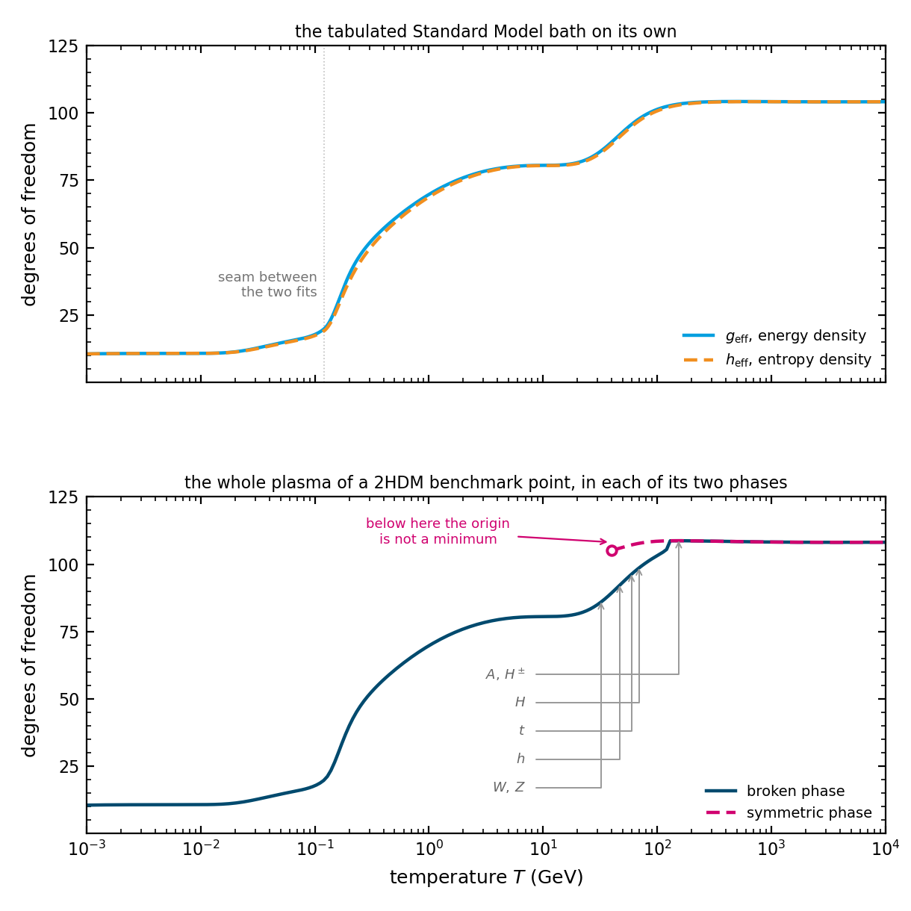

.. _algorithm-plasma:

The plasma and its degrees of freedom
=====================================

The expansion rate, the energy released by the transition, the reheating that follows it and
the redshift of the spectrum all depend on how much radiation the universe contains. That is
counted as an effective number of degrees of freedom, and the counting has to be done once:
every species has to appear exactly once, and no species may be left out.

This is harder than it sounds, because TransitionListener holds the plasma in two separate
inventories that have to be kept from overlapping.

Two inventories
---------------

The fields that appear in the effective potential are counted mode by mode, with the masses
they have at the field value and temperature in question. Their contribution changes as the
field moves, which is exactly what makes the two phases differ, so they cannot be taken from a
table.

Everything else is counted from tabulated radiation baths: a kinetically coupled bath, which by
default holds the Standard Model, and a kinetically decoupled bath, which can hold a secluded
sector. These are functions of temperature alone.

Every particle must appear in exactly one of the two. For a model whose potential contains no
Standard Model fields the division is clean. For one that does, such as a two-Higgs-doublet
model, the same fields are in the potential and in the table, and something must remove the
overlap.

Counting the fields of the potential
------------------------------------

In the Landau gauge the modes of the potential are not the physical particles
[ArnoldEspinosaPlasma]_. Each gauge boson
contributes two transverse modes and one longitudinal mode, each broken generator adds a
Goldstone mode, and each gauge boson is accompanied by a ghost that removes one bosonic degree
of freedom. The gauge-dependent pieces cancel between themselves, as they must, and what is
left is the physical count. For the Standard Model fields of a two-Higgs-doublet model at the
zero-temperature vacuum,

.. math::
   \underbrace{1}_{h} + \underbrace{1+2}_{G^0,\,G^\pm}
   + \underbrace{2+1}_{Z_{\rm T},\,Z_{\rm L}}
   + \underbrace{2+1}_{\gamma_{\rm T},\,\gamma_{\rm L}}
   + \underbrace{4+2}_{W_{\rm T},\,W_{\rm L}}
   - \underbrace{4}_{\rm ghosts} \;=\; 12
   \;=\; \underbrace{1}_{h} + \underbrace{3}_{Z} + \underbrace{6}_{W^\pm}
   + \underbrace{2}_{\gamma},

and with the top, bottom and tau included this is
:math:`12 + \tfrac{7}{8}\times 28 = 36.5` at temperatures far above the masses.

That number is the bridge between the two inventories.

Removing the overlap
--------------------

Exactly those degrees of freedom are subtracted from the tabulated bath, at the masses the
fields have in the zero-temperature vacuum. The books then close: in that vacuum the potential
adds precisely what the table loses, and the total is the full tabulated bath plus whatever
additional fields the model carries. Away from the vacuum the fields of the potential follow
their field-dependent masses, which is what makes the two phases differ, while the table
continues to supply the light species at the temperature in question.

.. versionchanged:: 2.2
   Before, the overlap was removed by freezing the tabulated Standard Model above half the mass
   of the lightest massive field that the potential carried. That froze the photon, the gluons,
   the light fermions and the quantum chromodynamic crossover along with the fields it was
   meant to exclude, and it was stored for the whole module rather than for one model, so
   constructing one model changed the counting for every other model in the same session.

   The degrees of freedom of the fields of the potential were also counted incorrectly: fields
   flagged as belonging to the Standard Model were masked out entirely, the Goldstone modes
   were skipped, and the ghosts were kept. All modes are now counted and one ghost per gauge
   boson is subtracted, which is the gauge counting the energy density had always used.

   The upper panel shows the Standard Model bath as the package tabulates it. The step near
   0.2 GeV is the quark-gluon plasma turning into hadrons and the one near 100 GeV is the
   electroweak scale. The plateau at high temperature sits at 104.1 rather than the free-field
   106.75, because the fit carries the interaction correction to the quark-gluon free energy.
   The energy and entropy counts differ wherever a species is neither relativistic nor gone,
   which is at and above the quark-hadron step, by at most 6.7 per cent at 0.2 GeV. Below
   about 0.5 MeV they part permanently, since the neutrinos no longer share the photons'
   temperature once electrons and positrons have annihilated, and the inset is the only place
   that can be seen, because 3.38 against 3.93 is half a per cent of the main panel. The two
   fits meet at 0.12 GeV, and the small discontinuity there belongs to the fits and not to the
   physics.

   The lower panel shows the whole plasma of the two Higgs doublet model at the benchmark of
   ``examples/bp_lisa.yaml``, on the same temperature axis, counted separately in each of its
   two phases. Both curves carry the tabulated bath as well as the fields of the potential,
   with the Standard Model fields that appear in both counted once, so this is what the
   expansion rate is built from. In the symmetric phase the fields of the potential are
   massless and contribute their full 40.5; in the broken phase they take their masses from
   the field and leave the plasma one after another, and the arrows mark where each has lost
   half of its contribution, solved from the same integral the counting uses rather than read
   off :math:`m = T`. The symmetric phase is drawn only where it exists as a minimum and where
   that verdict is resolved: the curvature at the origin is a finite difference of the full
   potential, and above about a TeV the field-independent radiation dominates the potential
   and is differenced away, leaving a number whose sign is an accident of rounding. The two
   curves meet where the broken minimum disappears. A model with a transition therefore has
   two different plasmas on the two sides of its bubble walls, which is why the count is taken
   at a field value and not only at a temperature.

The two radiation baths
-----------------------

Radiation that is not part of the potential belongs to one of two baths, set in the model's
``init``.

Radiation that is not part of the potential belongs to one of two baths, set
in the model's ``init``:

- ``kin_coupled_e_geff`` and ``kin_coupled_p_geff`` (default: the Standard
  Model) describe radiation in thermal contact with the fields of the
  potential. Together they form the transitioning sector, which is reheated
  inside the bubbles.
- ``kin_decoupled_e_geff`` and ``kin_decoupled_p_geff`` (default: empty)
  describe radiation that is not. It is not reheated inside the bubbles, keeps
  the temperature of the surrounding false vacuum and enters the expansion rate
  and the redshift of the gravitational-wave spectrum. With
  ``pot.config.gwConf.coupled_hydrodynamics = True`` (the default) it also moves
  with the fluid and enters the hydrodynamics and the strength ``alpha``.

For a dark sector decoupled from the Standard Model, move ``e_geffSM`` and
``p_geffSM`` from the coupled to the decoupled bath, set the coupled bath to
zero, and set ``pot.config.gwConf.coupled_hydrodynamics = False``, so that the
Standard Model does not enter the hydrodynamics either. TL takes the bath whose
tables are ``e_geffSM`` as the Standard Model bath; if the tables are wrapped,
set ``self.SM_bath = "decoupled"`` (or ``"coupled"``) in the model. It warns if
both baths hold ``e_geffSM``. A model whose potential contains Standard Model
fields (flagged ``is_SM``, e.g. the 2HDM) has the Standard Model in its
transitioning sector; TL then refuses a decoupled Standard Model, while other
radiation, e.g. of a dark sector, can still go into the decoupled bath.

Both baths share the temperature before the transition, so ``Tnuc_SM_GeV`` and
``Tperc_SM_GeV`` apply to both. ``Treh_SM_GeV`` is the temperature of the
Standard Model bath at reheating, which happens at percolation: the reheated
temperature if the Standard Model is coupled, ``Tperc`` if it is decoupled.
``Treh_DS_GeV`` is the reheating temperature of the transitioning sector.
``g_eff_tot_reh`` and ``h_eff_tot_reh`` sum the fields of the potential, the
coupled bath and the decoupled bath, each weighted by its temperature ratio to
the Standard Model bath to the fourth and third power. The redshift assumes
that the energy and entropy of the dark sector end up in the photon bath
without entropy injection (dilution factor ``D = 1``). Two simplifications
apply: the decoupled bath is evaluated at the temperature of the transitioning
sector until the transition, although the two can drift apart where the
degrees of freedom of either change, and the evolution of the temperature ratio
after the transition is not modelled. For the same reason a decoupled bath is
only consistent for the first of several transitions: after it, the bath is
colder than the transitioning sector.

.. versionchanged:: 2.2
   The redshift of the spectrum is taken from the temperature of the bath that carries the
   entropy rather than from the sector that underwent the transition. The two differ whenever
   the sectors are not in equilibrium.

In the code
-----------

``thermodynamics.potential_fields_geff`` counts the fields of a potential in the gauge counting
above, for the energy density, the pressure or the entropy. ``sm_fields_in_potential_geff``
returns what those fields contribute to the tables, ghosts included, and zero for a model whose
potential carries none of them. ``generic_potential.radiationEnergyDensity`` subtracts the one
from the other. ``generic_potential._check_radiation_baths`` warns where a potential carrying
Standard Model fields is given a coupled bath that is not the Standard Model table, since the
subtraction then removes species the bath may not contain.

A longer account, including the thermal functions and the resummation, is in
:doc:`the_effective_potential`.

References
----------

.. [ArnoldEspinosaPlasma] P. Arnold and O. Espinosa, *The effective potential and first order
   phase transitions: beyond leading-order*, Phys. Rev. D **47** (1993) 3546. The resummation
   whose counting of the longitudinal modes this bookkeeping has to match.
