.. _algorithm-plots:

Plots a run can produce
=======================

Besides the numbers, a run can draw what it computed. Each plot is switched on in the
``additional_plots`` section of the configuration file, and each is the state of one stage of
the pipeline rather than a summary of the result, so they are the first place to look when a
point behaves oddly.

Every figure on this page was produced by the configuration shown beside it, run on the
conformal dark :math:`U(1)` model of ``examples/example_point.yaml`` at
:math:`g = 0.7`, :math:`v = 0.1` GeV and :math:`y = 0.01`.

The potential
-------------

.. code-block:: yaml

   additional_plots:
     potential:
       plot?: True
       T_GeV: 0.02
       phi_ranges_GeV: [0, 0.15]
       n: 400

The effective potential along the field directions at one temperature. This is the plot that
shows whether there is a barrier at all, and how deep the broken minimum has become. A
potential that is not smooth here is a model problem and everything downstream of it is
unreliable.

.. figure:: ../_static/plots/potential.png
   :width: 100%

   The potential at 0.020 GeV, just below the critical temperature of 0.0218 GeV. The
   barrier at :math:`\phi = 0.042` GeV separates the symmetric minimum at the origin from the
   broken one at :math:`\phi = 0.0965` GeV, and is 81 per cent as high as the broken minimum
   is deep.

The phases
----------

.. code-block:: yaml

     phases:
       plot?: True
       include_transitions?: False

Every minimum the tracer followed, against temperature, which is the output of
:doc:`phases_and_transitions`. A phase that stops early, jumps, or wanders away from a smooth
curve is the tracer losing it, and that is visible here and almost nowhere else.
``include_transitions?`` adds the candidate transitions between them.

.. figure:: ../_static/plots/phases.png
   :width: 100%

   The two phases the tracer followed. The symmetric phase, with the field at the origin,
   exists at every temperature; the broken phase ends at 0.025 GeV, where its minimum stops
   being a minimum. A phase that ends where the potential says it should is the tracer
   working; a phase that ends in the middle of a smooth curve is the tracer losing it.

The action
----------

.. code-block:: yaml

     action:
       plot?: True
       Tmin_GeV: 0
       Tmax_GeV: 0.022
       phase_indices: [0, 1]
       n: 100

The bounce action :math:`S_3/T` against temperature for one pair of phases, which is what
:doc:`the_bounce_action` produces and what the nucleation rate is built from. The rate depends
on it exponentially, so a wobble of one per cent here is a factor of several in the rate: this
is the plot on which an unresolved bounce shows up.

.. figure:: ../_static/plots/action.png
   :width: 100%

   The action against temperature.

The energy density
------------------

.. code-block:: yaml

     energy_density:
       plot?: True
       Tmin_GeV: 0.002
       Tmax_GeV: 0.026

The energy density of each phase against temperature. The gap between the two is the energy
the transition has to release, so this is where a transition strength that looks surprising
can be checked against the thermodynamics it came from.

.. figure:: ../_static/plots/rho.png
   :width: 100%

   The energy density of the two phases.

The degrees of freedom
----------------------

.. code-block:: yaml

     dofs:
       plot?: True
       Tmin_GeV: 0.002
       Tmax_GeV: 0.03

The effective degrees of freedom of the plasma against temperature, in the sense of
:doc:`the_plasma`, which fix the expansion rate and the redshift of the signal.

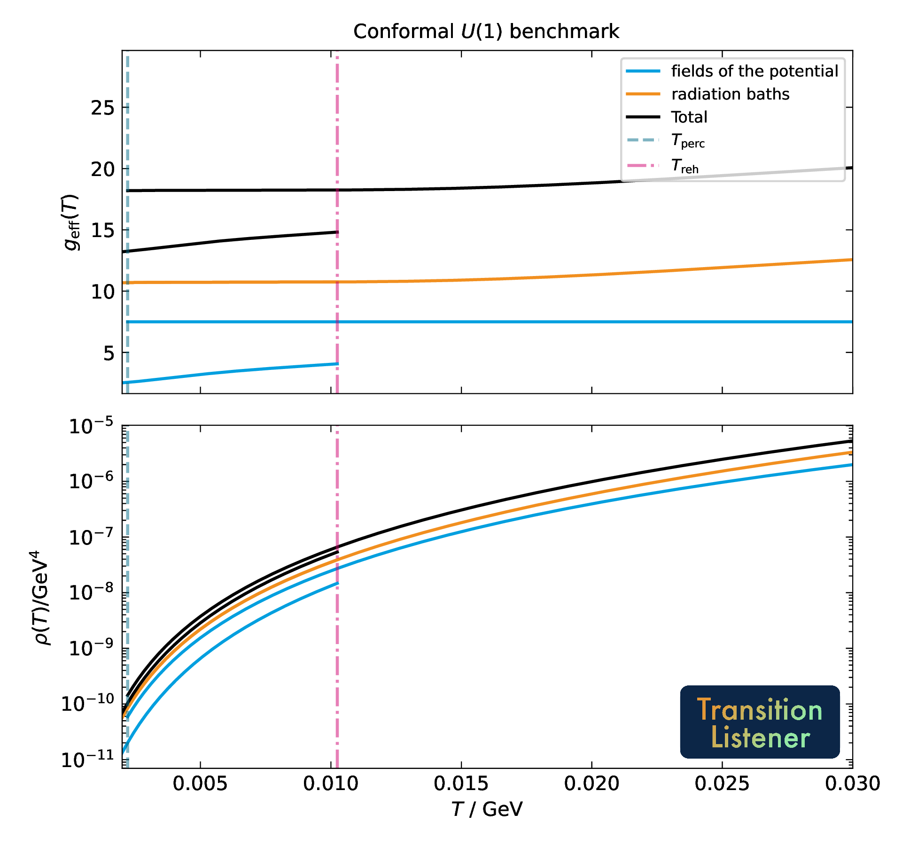

   The counts and the energy densities of this benchmark point, split into the fields of the
   potential and the tabulated baths. Each quantity is drawn once per phase, so the pair of
   curves of one colour is the same quantity in the symmetric and in the broken phase, and
   the percolation and reheating temperatures are marked.

The percolation history
-----------------------

.. code-block:: yaml

     percolation:
       plot?: True
       Tmin_GeV: 0.00235
       Tmax_GeV: 0.00285

The true-vacuum fraction :math:`P_\mathrm{t}(T)` against temperature, with the nucleation and
percolation temperatures marked, which is the subject of :doc:`nucleation_and_percolation`.
The fraction is recomputed for the plot rather than read back from the run, so
``Tmin_GeV`` and ``Tmax_GeV`` are worth setting to a window around the transition: over the
whole range of the scan the rise is one vertical line.

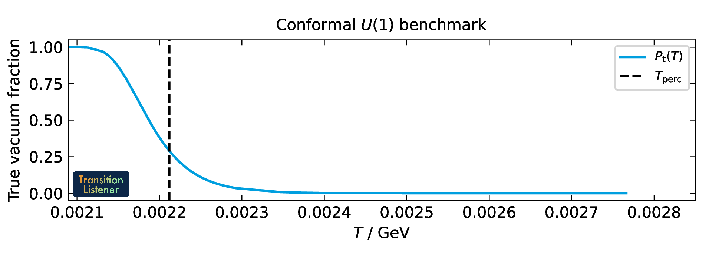

   The true-vacuum fraction of this benchmark point. Temperature falls to the left, so the
   fraction rises from zero to one from right to left. The percolation temperature is where
   the false vacuum has fallen to 0.71 of the volume, which is the dashed line.

The bubble profile
------------------

.. code-block:: yaml

     profile:
       plot?: True

     profileV:
       plot?: True
       field_index_1: 0
       field_index_2: 1

The field through the wall of the critical bubble at the nucleation temperature, and the path
it takes through field space over the potential. The second is the one that shows whether the
path deformation found a sensible path or cut a corner.

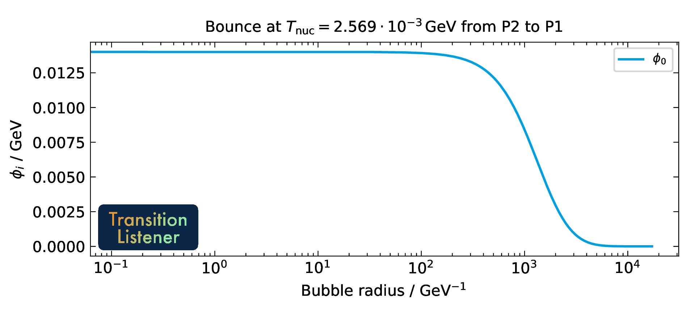

   The bounce of this benchmark point. The field sits at the true vacuum inside the bubble,
   falls through the wall at a radius of about 1000 inverse GeV, and reaches the false vacuum
   outside. A profile that stops before it reaches the false vacuum is an unresolved bounce.

The spectrum and the detectors
------------------------------

.. code-block:: yaml

     gw_spectrum:
       plot?: True

     sensitivities:
       plot?: True

The gravitational wave spectrum with its three sources, and the same spectrum against the
sensitivity curves of the detectors that ship with the package, as in :doc:`the_spectrum`.

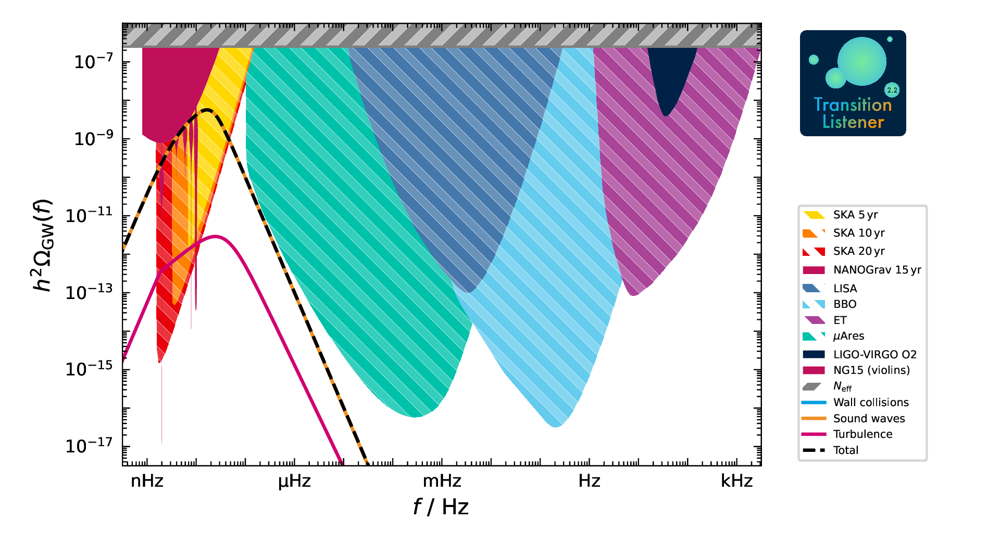

   The spectrum of this benchmark point against the detectors, with the three sources drawn
   separately. The sound waves carry almost all of the signal here, so their curve lies under
   the total.

.. figure:: ../_static/plots/GW_sensitivities.png
   :width: 100%

   The detector sensitivities on their own, which is what ``sensitivities`` draws.

Plots a scan can produce
------------------------

A scan over a grid of model parameters draws one map per output. The gallery below comes from
``examples/example_grid.yaml``, a ten by ten grid of the abelian dark Higgs model of
``models/TL_dark_U1.py``, run with

.. code-block:: console

   $ tl -c examples/example_grid.yaml -j 10

Each panel is a thumbnail; the full-size file is behind it.

Transition strength and the milestone temperatures
~~~~~~~~~~~~~~~~~~~~~~~~~~~~~~~~~~~~~~~~~~~~~~~~~~

These panels say how the strength and the characteristic temperatures vary across a
two-dimensional grid of model parameters.

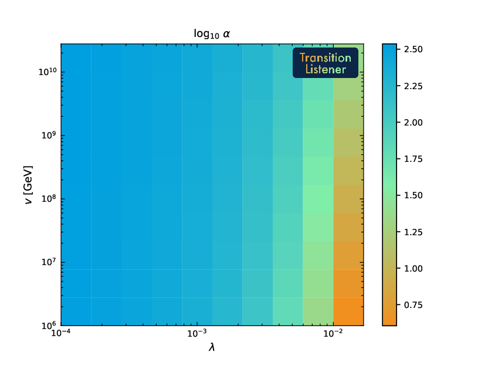

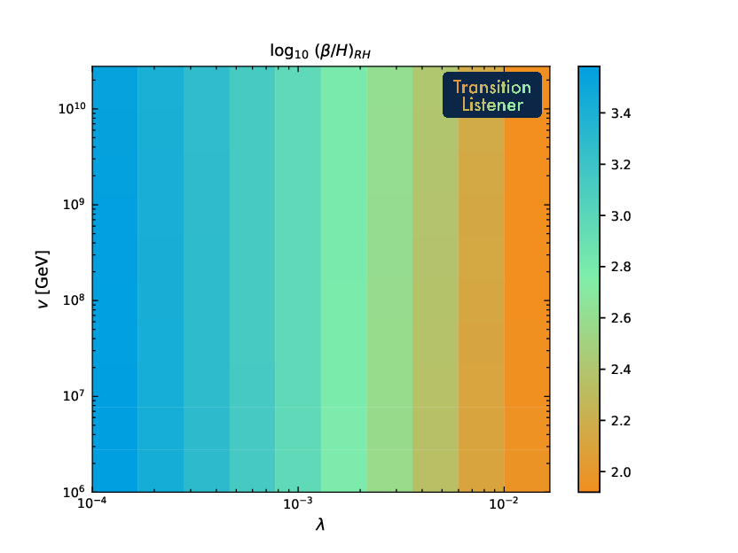

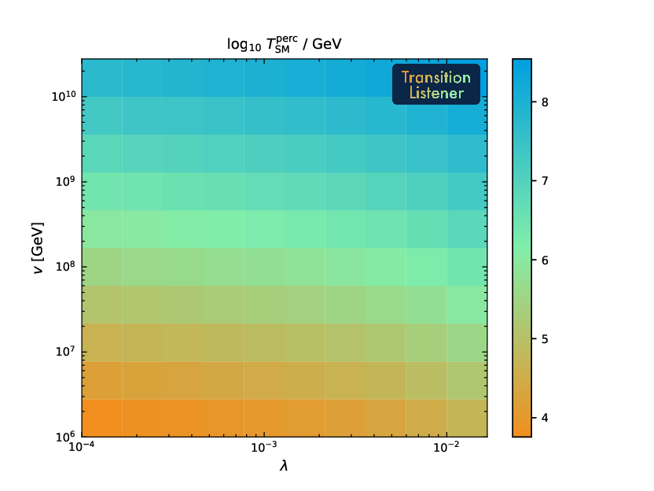

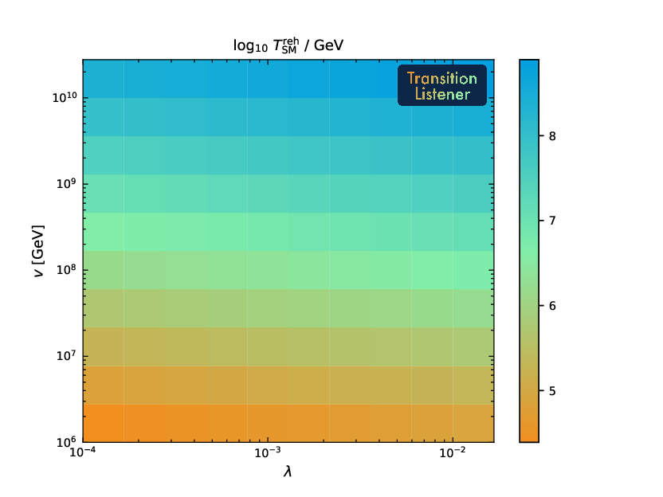

The plasma and its thermodynamics
~~~~~~~~~~~~~~~~~~~~~~~~~~~~~~~~~

These expose the background quantities that enter the time-temperature relation and the
macroscopic observables.

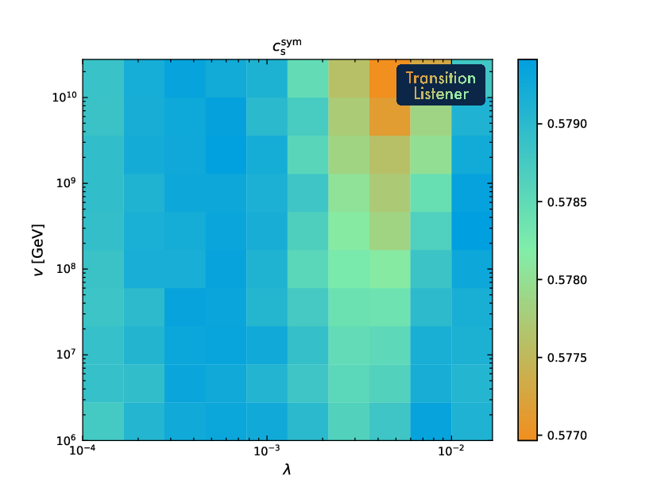

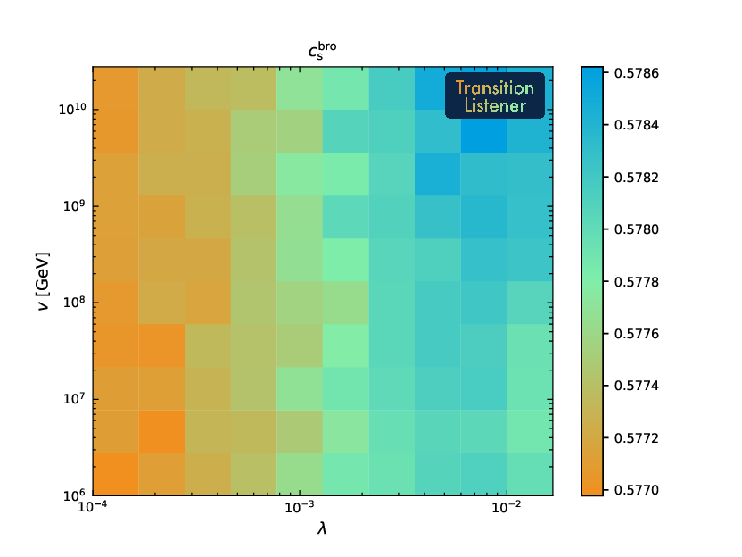

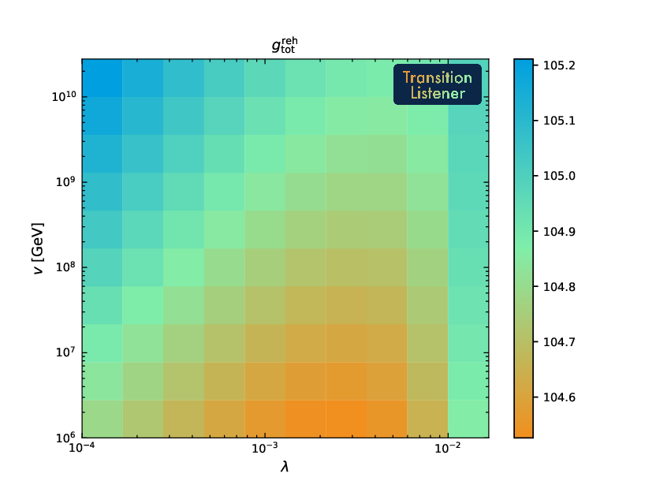

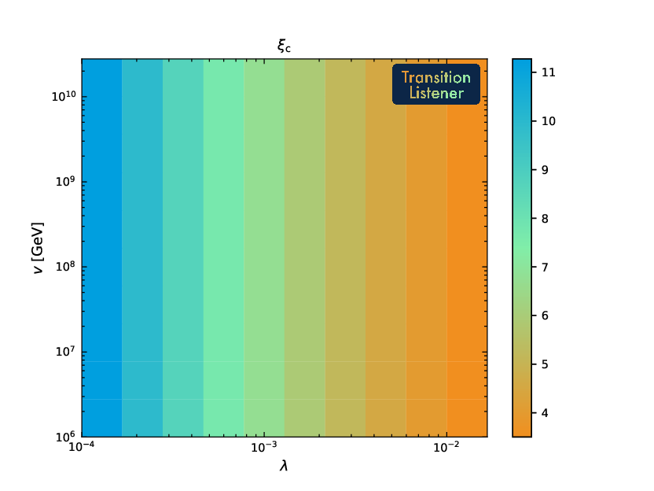

The peak of the spectrum
~~~~~~~~~~~~~~~~~~~~~~~~

The frequency and the amplitude at which the predicted spectrum peaks, across the scan.

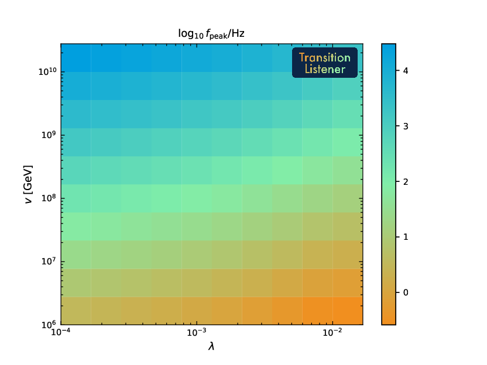

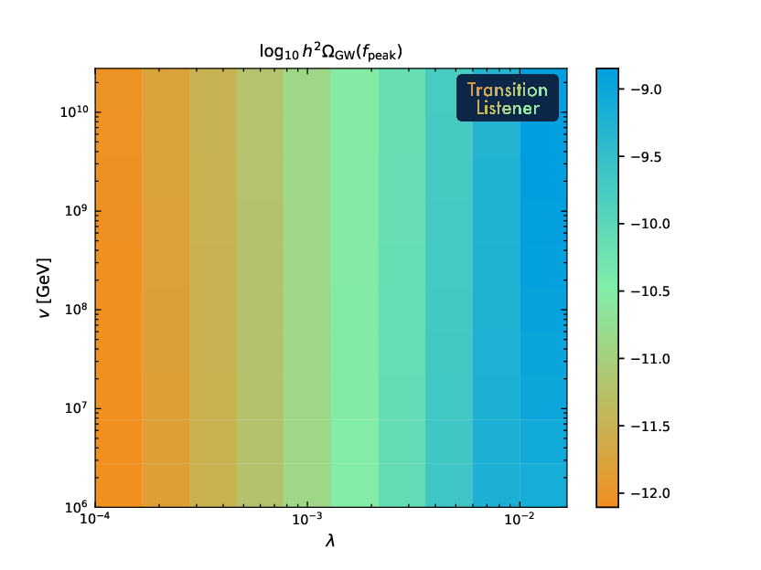

The reach of the detectors
~~~~~~~~~~~~~~~~~~~~~~~~~~

How the predicted signals map into the signal-to-noise ratio of three future detectors.

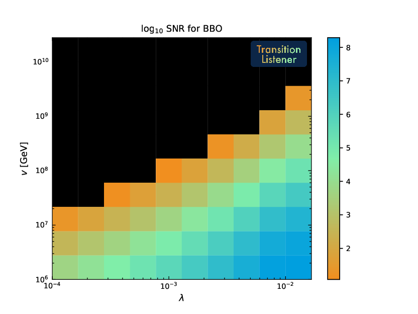

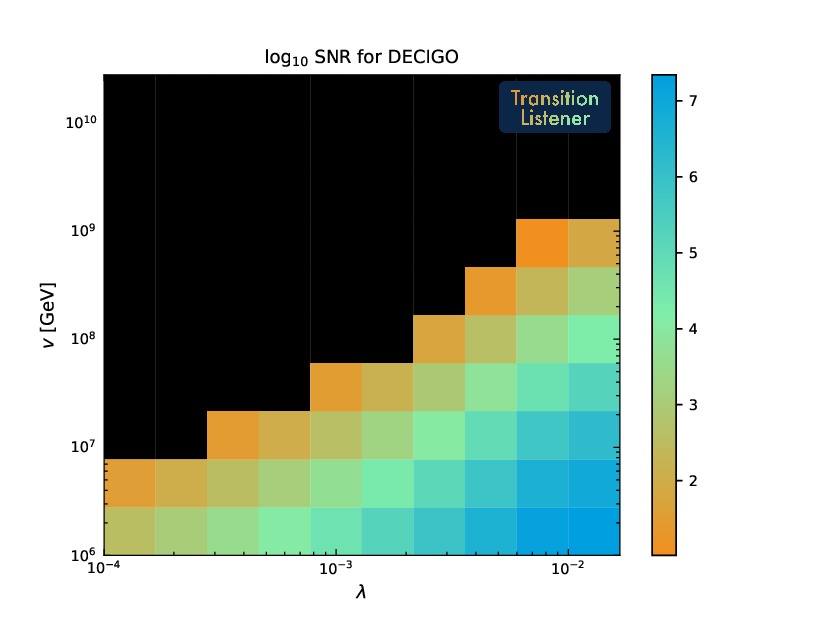

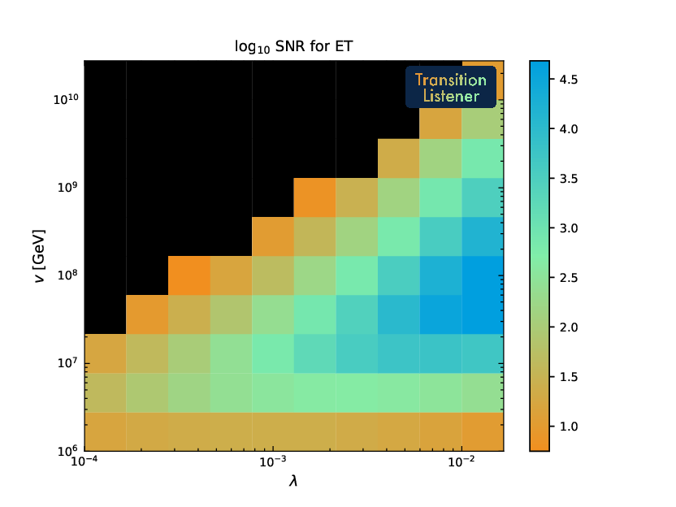

In the code
-----------

``plots.TLPlots`` holds the per-stage plots, with ``plotPotential``, ``plotPhases``,
``plotAction``, ``plotEnergyDensity``, ``plotDOFs``, ``plotPercolation``, ``plotProfile`` and
``plotProfileV``. ``plotGWSpectrum`` and ``plotSensitivities`` draw the spectrum.
``plot_settings`` holds the style, and ``colors`` the palette.
