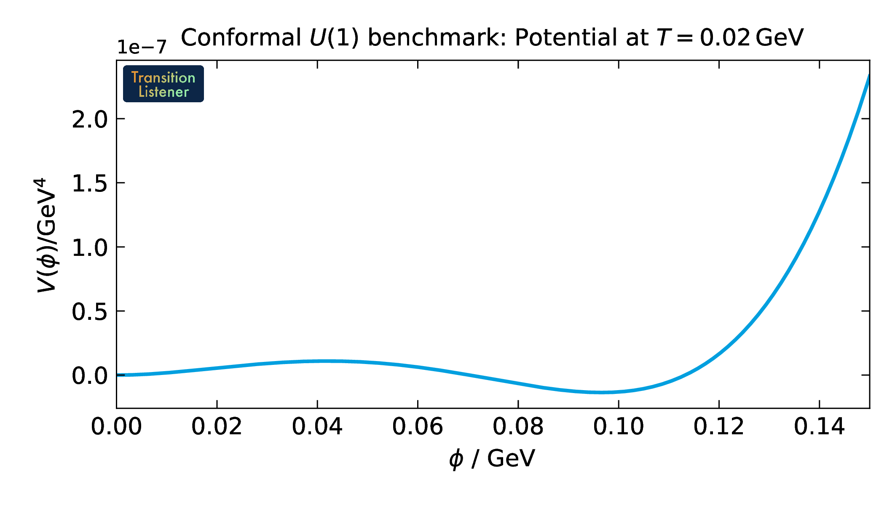
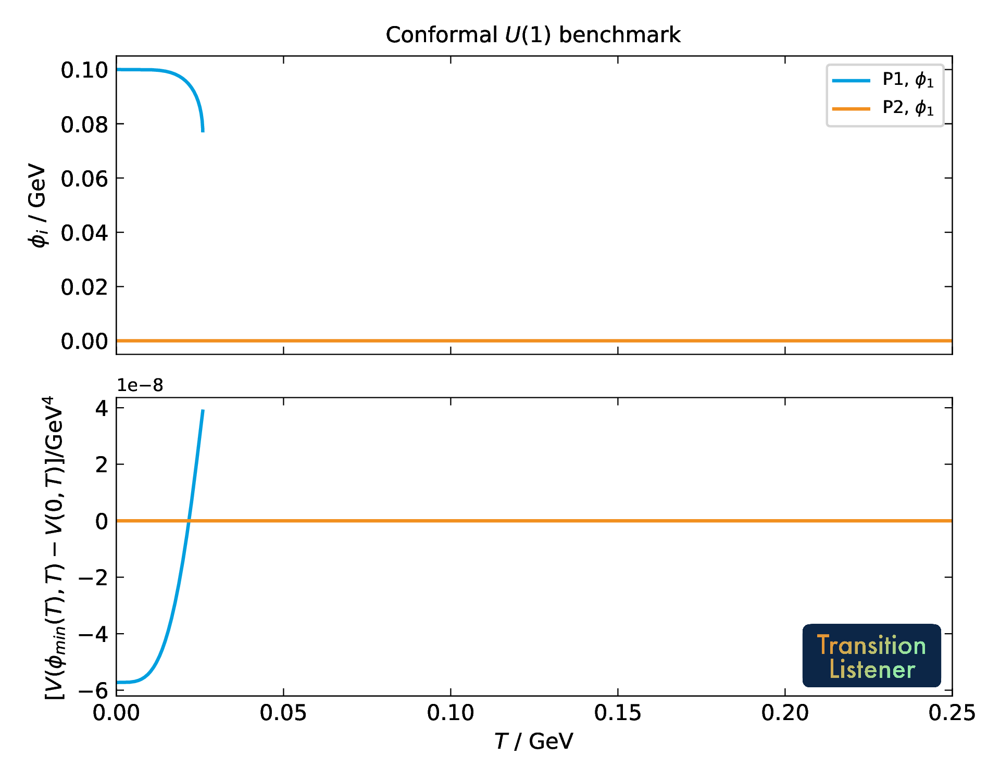
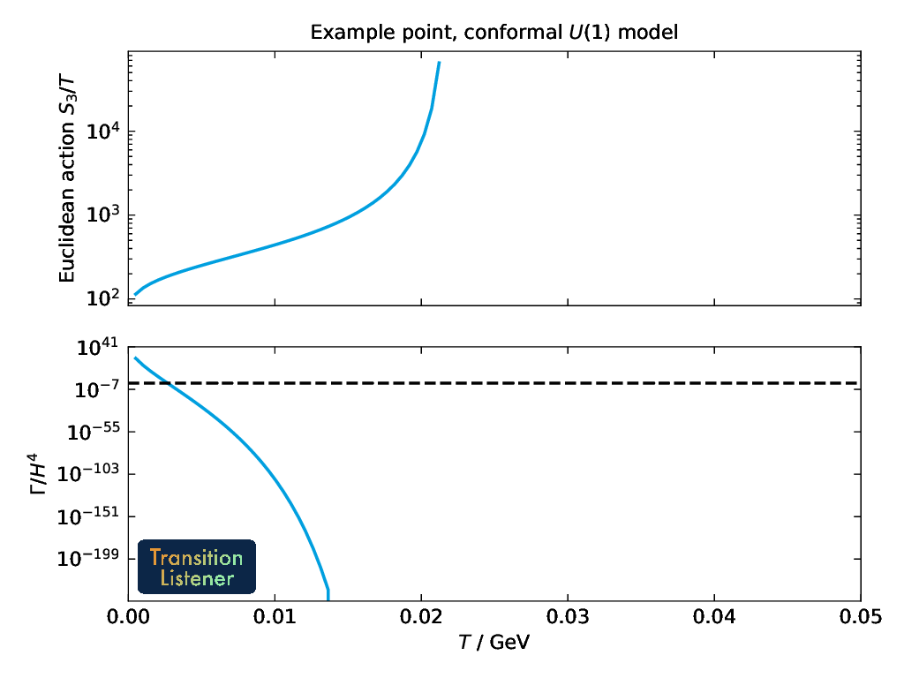
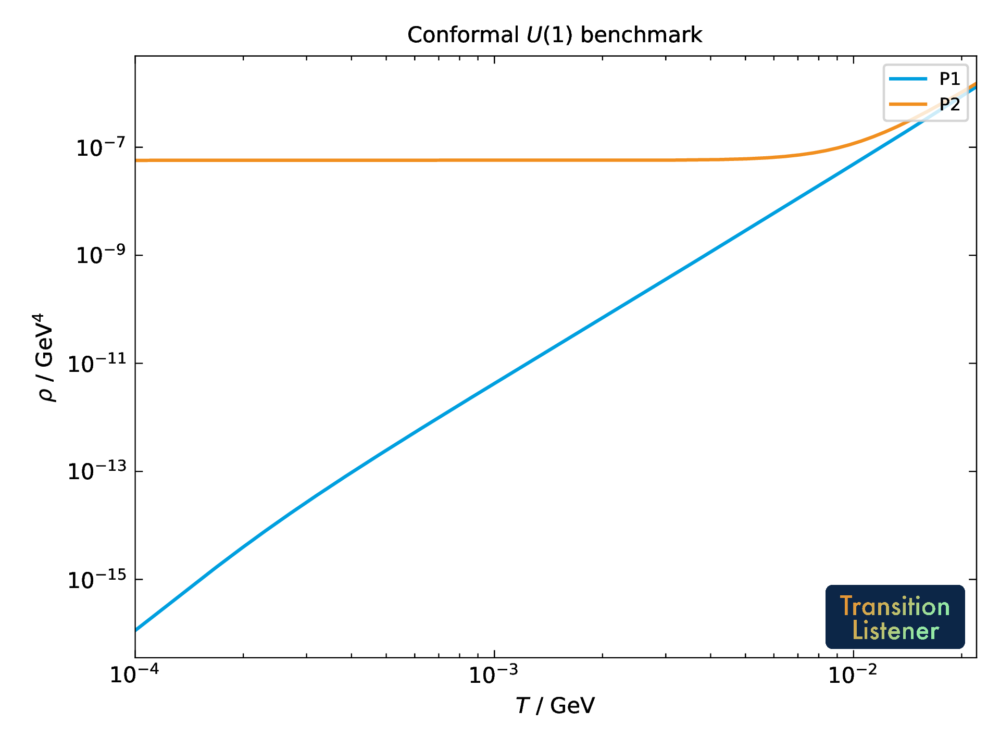
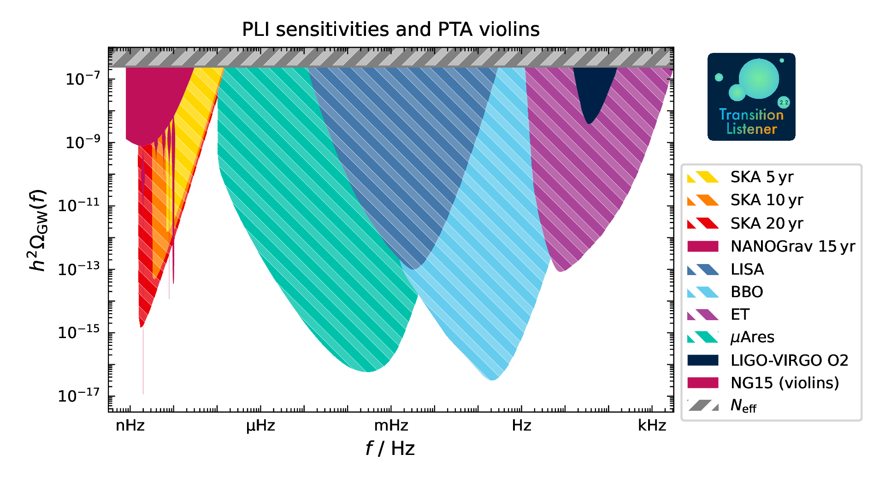

.. _algorithm-plots:

The plots a run can make
========================

Besides the numbers, a run can draw what it computed. Each plot is switched on in the
``additional_plots`` section of the configuration file, and each is the state of one stage of
the pipeline rather than a summary of the result, so they are the first place to look when a
point behaves oddly.

Every figure on this page was produced by the configuration shown beside it, run on the
conformal dark :math:`U(1)` model of ``examples/example_point.yaml`` at
:math:`g = 0.7`, :math:`v = 0.1` GeV and :math:`y = 0.01`.

The potential
-------------

.. code-block:: yaml

   additional_plots:
     potential:
       plot?: True
       T_GeV: 0.02
       phi_ranges_GeV: [0, 1]
       n: 100

The effective potential along the field directions at one temperature. This is the plot that
shows whether there is a barrier at all, and how deep the broken minimum has become. A
potential that is not smooth here is a model problem and everything downstream of it is
unreliable.

   The potential at 0.02 GeV.

The phases
----------

.. code-block:: yaml

     phases:
       plot?: True
       include_transitions?: False

Every minimum the tracer followed, against temperature, which is the output of
:doc:`phases_and_transitions`. A phase that stops early, jumps, or wanders away from a smooth
curve is the tracer losing it, and that is visible here and almost nowhere else.
``include_transitions?`` adds the candidate transitions between them.

   The traced phases.

The action
----------

.. code-block:: yaml

     action:
       plot?: True
       Tmin_GeV: 0
       Tmax_GeV: 0.05
       phase_indices: [0, 1]
       n: 100

The bounce action :math:`S_3/T` against temperature for one pair of phases, which is what
:doc:`the_bounce_action` produces and what the nucleation rate is built from. The rate depends
on it exponentially, so a wobble of one per cent here is a factor of several in the rate: this
is the plot on which an unresolved bounce shows up.

   The action against temperature.

The energy density
------------------

.. code-block:: yaml

     energy_density:
       plot?: True
       Tmin_GeV: 0.01
       Tmax_GeV: 0.05

The energy density of each phase against temperature. The gap between the two is the energy
the transition has to release, so this is where a transition strength that looks surprising
can be checked against the thermodynamics it came from.

   The energy density of the two phases.

The degrees of freedom
----------------------

.. code-block:: yaml

     dofs:
       plot?: True
       Tmin_GeV: 0.01
       Tmax_GeV: 0.05

The effective degrees of freedom of the plasma against temperature, in the sense of
:doc:`the_plasma`, which fix the expansion rate and the redshift of the signal.

The percolation history
-----------------------

.. code-block:: yaml

     percolation:
       plot?: True

The converted fraction and the nucleation rate across the support the solver built, which is
the subject of :doc:`nucleation_and_percolation`. The support points are drawn, so this plot
answers directly whether the solver put its samples where the fraction was rising.

The bubble profile
------------------

.. code-block:: yaml

     profile:
       plot?: True

     profileV:
       plot?: True
       field_index_1: 0
       field_index_2: 1

The field through the wall of the critical bubble at the nucleation temperature, and the path
it takes through field space over the potential. The second is the one that shows whether the
path deformation found a sensible path or cut a corner.

The spectrum and the detectors
------------------------------

.. code-block:: yaml

     gw_spectrum:
       plot?: True

     sensitivities:
       plot?: True

The gravitational wave spectrum with its three sources, and the same spectrum against the
sensitivity curves of the detectors that ship with the package, as in :doc:`the_spectrum`.

   The spectrum against the detectors.

In the code
-----------

``plots.TLPlots`` holds the per-stage plots, with ``plotPotential``, ``plotPhases``,
``plotAction``, ``plotEnergyDensity``, ``plotDOFs``, ``plotPercolation``, ``plotProfile`` and
``plotProfileV``. ``plotGWSpectrum`` and ``plotSensitivities`` draw the spectrum.
``plot_settings`` holds the style, and ``colors`` the palette.
