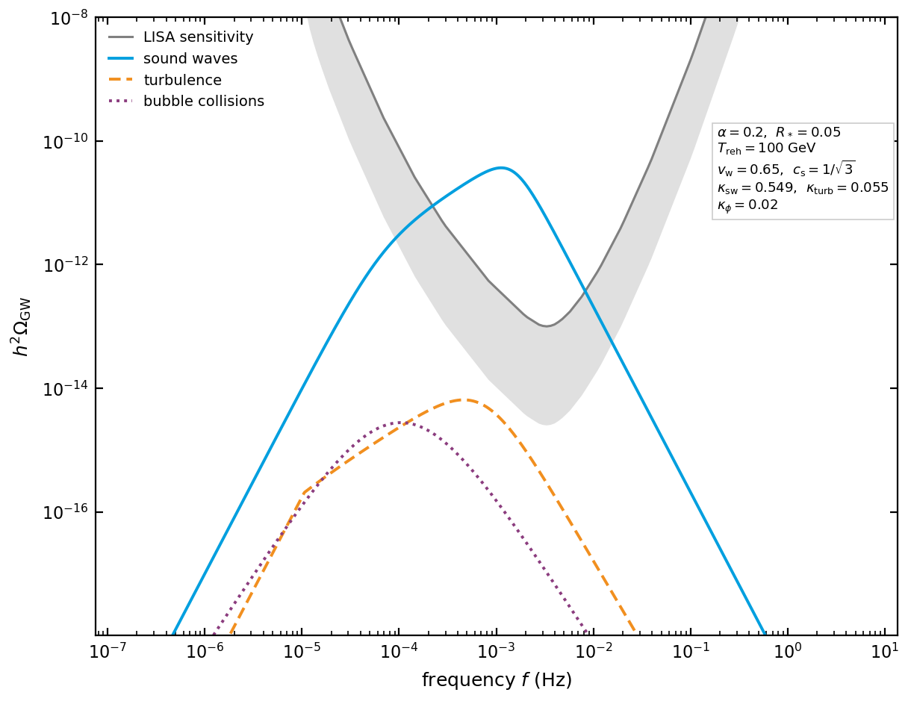

.. _algorithm-spectrum:

The gravitational wave spectrum
===============================

The transition leaves a stochastic background of gravitational waves. Its amplitude and the
frequency at which it peaks follow from four numbers computed earlier: the strength
:math:`\alpha`, the mean bubble separation :math:`R_*`, the temperature :math:`T_\mathrm{reh}`
after the released energy has been shared out, and the wall velocity :math:`v_\mathrm{w}`.

This page describes the spectrum as the code builds it. The templates follow the report of the
LISA Cosmology Working Group [LISACosWG2024]_, and the equation numbers quoted below are that
report's.

The spectrum is built in :py:mod:`transitionlistener.gwfopt` and compared with the
detectors in :py:mod:`transitionlistener.observability`.

The three sources
-----------------

Three processes radiate, and their spectra are added:

.. math::
   h^2\Omega_\mathrm{GW}(f) = h^2\Omega_{\phi}(f) + h^2\Omega_\mathrm{sw}(f)
                           + h^2\Omega_\mathrm{turb}(f).

The sum, :math:`\Omega_\mathrm{GW}`, is what a detector would see. Its three terms are these.

Bubble collisions, :math:`\Omega_\phi`, from the energy that stays in the scalar field and
radiates when walls meet. This matters when the wall runs away, so that much of the energy
never reaches the plasma.

Sound waves, :math:`\Omega_\mathrm{sw}`, from the bulk motion left in the plasma after the
walls have passed. On most transitions this dominates.

Turbulence, :math:`\Omega_\mathrm{turb}`, from the fraction of that motion which becomes
vortical.

Kinetic energy fractions
------------------------

Each source carries a fraction of the energy released. Writing

.. math::
   K_i = \,\varepsilon_i \,\kappa_i \,\frac{\alpha}{1+\alpha},

the factor :math:`\alpha/(1+\alpha)` is the released energy as a fraction of the total, and
:math:`\kappa_i` is the efficiency with which it reaches that source, computed in
:doc:`hydrodynamics`. For the sound waves and the turbulence
:math:`\varepsilon = 0.6`, which accounts for the efficiency of producing bulk motion relative
to the single-bubble case as found in the Higgsless simulations of [Jinno2022]_. For the
scalar field :math:`\varepsilon = 1`.

Redshift to today
-----------------

A spectrum produced at :math:`T_\mathrm{reh}` is diluted by the expansion since then. The
amplitude carries

.. math::
   R = \frac{\Omega_{\gamma,0} h^2}{D^{4/3}}
       \left(\frac{h_\mathrm{eff,0}}{h_\mathrm{eff,reh}}\right)^{4/3}
       \frac{g_\mathrm{eff,reh}}{g_\mathrm{eff,0}},

with :math:`g_\mathrm{eff}` and :math:`h_\mathrm{eff}` the degrees of freedom in the energy density
and in the entropy from :doc:`the_plasma`, and :math:`D` the dilution factor where the
transitioning sector is not in equilibrium with the bath that carries the entropy. The Hubble
rate at the transition, redshifted to today, is

.. math::
   H_{*,0} = 1.65\times 10^{-5}\,\mathrm{Hz}\; D^{-1/3}\,
             \frac{T_\mathrm{reh}}{100\,\mathrm{GeV}}
             \left(\frac{g_\mathrm{eff,reh}}{100}\right)^{1/2}
             \left(\frac{100}{h_\mathrm{eff,reh}}\right)^{1/3},

and every frequency below is quoted in units of it.

.. versionchanged:: 2.2
   The redshift is applied from the temperature of the bath that carries the entropy rather
   than from the sector that underwent the transition. The two differ when the sectors are not
   in equilibrium.

Spectral shapes
---------------

Two shapes are used. A broken power law, their equation (2.4),

.. math::
   S(f) = \left(\frac{f}{f_\mathrm{b}}\right)^{n_1}
          \left[\frac{1}{2} + \frac{1}{2}\left(\frac{f}{f_\mathrm{b}}\right)^{a_1}
          \right]^{(n_2-n_1)/a_1},

which rises as :math:`f^{n_1}` below the break and falls as :math:`f^{n_2}` above it, with
:math:`a_1` setting how sharply it turns. And a double broken power law, their equation (2.8),

.. math::
   S(f) = \left(\frac{f}{f_1}\right)^{n_1}
          \left[1+\left(\frac{f}{f_1}\right)^{a_1}\right]^{(n_2-n_1)/a_1}
          \left[1+\left(\frac{f}{f_2}\right)^{a_2}\right]^{(n_3-n_2)/a_2},

which has three slopes and two breaks, and is what the sound waves need.

Bubble collisions
-----------------

A single break, with

.. math::
   h^2\Omega_\phi^\mathrm{peak} = R\, A_\phi\,
       \frac{K_\phi^2}{(\beta/H)_\mathrm{RH}^2},
   \qquad
   f_\mathrm{b} = 0.11\,\left(\frac{\beta}{H}\right)_\mathrm{RH} H_{*,0},

their equation (2.7), and the shape parameters
:math:`A_\phi = 0.05`, :math:`n_1 = 2.4`, :math:`n_2 = -2.4`, :math:`a_1 = 1.2`. The inverse
duration here is the one read off the bubble separation,
:math:`(\beta/H)_\mathrm{RH} = (8\pi/f_\mathrm{perc})^{1/3}\max(v_\mathrm{w},c_\mathrm{s})/R_*`,
and never the local one of :doc:`the_observables`.

Sound waves
-----------

Two breaks. The lower one is set by the bubble separation and the upper one by the thickness
of the sound shell:

.. math::
   f_1 = \frac{0.2}{R_*}H_{*,0},
   \qquad
   f_2 = \frac{0.5}{R_*\,\Delta_\mathrm{w}}H_{*,0},
   \qquad
   \Delta_\mathrm{w} = \frac{|v_\mathrm{w} - c_\mathrm{s}|}{\max(v_\mathrm{w}, c_\mathrm{s})} .

:math:`\Delta_\mathrm{w}` is the shell thickness as a fraction of the bubble radius. A wall moving close
to the speed of sound leaves a thin shell, which pushes :math:`f_2` far above :math:`f_1` and
widens the flat part of the spectrum between them. This estimate assumes a detonation or a
deflagration, and a general solution would need the full hydrodynamic profile.

The integrated amplitude is their equation (2.10),

.. math::
   h^2\Omega_\mathrm{sw}^\mathrm{int} = R\, A_\mathrm{sw}\, K_\mathrm{sw}^2\, (H\tau_\mathrm{sw})\, R_* ,

where :math:`K_\mathrm{sw}` is the kinetic energy fraction of the sound waves defined above,
with :math:`A_\mathrm{sw} = 0.11` and the slopes :math:`n_1 = 3`, :math:`n_2 = 1`,
:math:`n_3 = -3`, :math:`a_1 = 2`, :math:`a_2 = 4`. The source does not last forever: the
sound waves decay once the shells have crossed, after a time

.. math::
   H\tau_\mathrm{sh} = \frac{R_*}{\sqrt{\tfrac{3}{4}\,\varepsilon\,\kappa_\mathrm{sw}\,
                    \alpha_\mathrm{hyd}/(1+\alpha_\mathrm{hyd})}},

where :math:`\kappa_\mathrm{sw}` is the sound-wave efficiency of :doc:`hydrodynamics` and
:math:`\alpha_\mathrm{hyd}` the transition strength at the wall, which the same page computes.
The lifetime entering the amplitude is :math:`H\tau_\mathrm{sw} = \min(1, H\tau_\mathrm{sh})`,
capped at one Hubble time. The rising part of the spectrum is :math:`f^3`, which is the causal
slope any uncorrelated source must have.

Turbulence
----------

Their equation (2.15), the full form rather than the approximation of their equation (2.25):

.. math::
   h^2\Omega_\mathrm{turb}(f) = 3 A_\mathrm{turb}\, \Omega_s^2\, R\, R_*^3
       \left(\frac{f}{H_{*,0}}\right)^3 p(f)\, T(f),

with :math:`\Omega_s = K_\mathrm{turb}` and :math:`A_\mathrm{turb} = 0.085`. The anisotropic
spectrum is

.. math::
   p(f) = \left[1+\left(\frac{f}{f_2}\right)^{a_2}\right]^{-11/(3a_2)},
   \qquad f_2 = \frac{2.2}{R_*}H_{*,0}, \qquad a_2 = 2.15,

and the transfer function carries the finite lifetime of the source,

.. math::
   T(f) = \begin{cases}
     \ln^2\!\left(1 + N H\tau_e\right), & f \le \dfrac{H_{*,0}}{2\pi N H\tau_e},\\[2ex]
     \ln^2\!\left(1 + \dfrac{H_{*,0}}{2\pi f}\right), & \mathrm{otherwise},
   \end{cases}

where :math:`N H\tau_e = N R_*/(2\pi v_A)` is the duration in Hubble times of :math:`N = 2`
eddy turnovers and :math:`v_A = \sqrt{3\Omega_s/4}` is the Alfvén velocity.

   The three templates, built with the package's own ``FOPTspectrum`` at the parameters shown.
   The sound-wave efficiency is taken from the fit of :doc:`hydrodynamics` at that strength
   and wall velocity and the turbulent one is a tenth of it. The collision efficiency is set
   by hand,
   since for a wall the plasma holds back it is zero and there would be nothing to draw. Their
   sum is not drawn, because the sound waves dominate and it would lie on top of them.

   The sound-wave spectrum rises as :math:`f^3`, turns over to :math:`f` between its two
   breaks and falls as :math:`f^{-3}`. With the breaks a factor twenty-two apart the middle
   segment is short, and what the eye reads is the change of curvature rather than a straight
   piece. The grey curve marked LISA is the power-law-integrated sensitivity as the package
   ships it, at the threshold and observation time stored with it, with a shallow shadow
   beneath it so that it reads as a band. A spectrum that rises above it is detectable, and
   this one does. The curve leaves the top of the panel at both ends, where the sensitivity is
   poor, and it does not stop there.

Observability
-------------

For an interferometer the spectrum is compared with a noise curve by the signal-to-noise ratio

.. math::
   \mathrm{SNR} = \sqrt{N\,\mathcal{T} \int \mathrm{d}f
                  \left[\frac{h^2\Omega_\mathrm{GW}(f)}{h^2\Omega_\mathrm{noise}(f)}\right]^2},

with :math:`\mathcal{T}` the observation time and :math:`h^2\Omega_\mathrm{noise}` the
detector's noise written as an energy density, so that the ratio under the integral is a
signal-to-noise density. :math:`N = 2` where the signal is cross-correlated between two
independent data streams, which is what the code assumes by default, and :math:`N = 1` for a
single instrument, which it applies to LISA, B-DECIGO, ET and muAres. Curves for the
interferometers and the pulsar timing arrays ship with the package.

For a pulsar timing array the comparison is made against the measured free spectrum rather
than a noise curve. The data is a posterior for the amplitude in each frequency bin, obtained
from a kernel density estimate, and the likelihood of a model is the product of those
posteriors evaluated at the amplitudes it predicts. What the code reports is the distance from
the best fit achievable on that data, as

.. math::
   \sigma = \sqrt{2\,\big(\ln L_\mathrm{best} - \ln L\big)} .

Four likelihoods are evaluated for every point, and each is a data set together with the
number of frequency bins the fit uses:

.. list-table::
   :header-rows: 1
   :widths: 22 30 48

   * - Key
     - Data
     - Bins
   * - ``NG15_14bins``
     - NANOGrav 15 yr
     - 14, the bins the collaboration's own searches use
   * - ``NG15_5bins``
     - NANOGrav 15 yr
     - 5, the lowest ones only
   * - ``NG12_5bins``
     - NANOGrav 12.5 yr
     - 5
   * - ``IPTA2_13bins``
     - IPTA DR2
     - 13

Each of the four is reported in three variants. ``PTArcade`` is the likelihood itself.
``mock`` is a quadratic in the distance of the peak frequency and the peak amplitude from a
reference point. The quadratic is defined everywhere, including where the signal is so far
from the data that the likelihood is flat to the precision it is computed with. ``smooth`` takes the
likelihood where it is above a threshold and the quadratic below it, so that a scan has a
quantity to interpolate across its whole plane. Only the first is a likelihood, and only the
first carries the three-sigma verdict.

Evaluating them needs ``ptarcade``, ``enterprise`` and ``tempo2``. Without them a run
computes the signal-to-noise ratios and says that the likelihood columns are unavailable,
rather than failing.

The shipped free spectra
~~~~~~~~~~~~~~~~~~~~~~~~

A free spectrum is not the raw data. It is the posterior for the amplitude in each frequency
bin, and inferring it takes a model of everything in the timing residuals that is not the
signal. Eight such products ship with the package and ``gw_pta_free_spectrum`` picks one.
They differ in two modelling choices, which their names record.

The first is the correlation assumed between pulsars:

* ``cp``, a common uncorrelated red process. Every pulsar carries red noise of the same
  spectrum and nothing correlates one pulsar with another, so the amplitude is attributed to
  a common source without asking whether its correlations are those of a gravitational-wave
  background. This is what PTArcade downloads.
* ``hd``, the Hellings-Downs curve. Pulsar pairs are correlated by the quadrupolar function
  an isotropic gravitational-wave background produces, and the amplitude is the one that
  correlation carries.
* ``hdall``, the Hellings-Downs curve together with a monopole, a dipole and a common
  uncorrelated process. Room is left for a clock error, which is monopolar, and for an error
  in the solar-system ephemeris, which is dipolar, so less of the signal is attributed to the
  background than under ``hd``.

The second is the dispersion measure, the column of free electrons along the line of sight,
which changes as the solar wind and the interstellar medium move across it. ``dmgp`` infers
it as a Gaussian process in time. The products without that mark use DMX instead, one free
dispersion measure per observing epoch, which is what the NANOGrav data sets carry by
default.

A trailing ``v1`` or ``v2`` separates the 2023 chains from the 2026 re-runs, made after a
correction to the sampler's parallel-tempering swaps. The default is ``ng15_hd_v2``, the 2026
Hellings-Downs re-run.

Each product carries its own best fit :math:`\ln L_\mathrm{best}`, because a distance in
log-likelihood only means something against a best fit obtained on the same data. Where a
product has no best fit for a label, the run leaves that label's distance and its three-sigma
verdict empty rather than filling them from another product's best fit.

.. versionchanged:: 2.2
   The free spectra ship with the package and are chosen with ``gw_pta_free_spectrum``, where
   one product was downloaded while the run was in progress and every PTA column rested on it.

.. admonition:: The templates have a range of validity
   :class: important

   The sound-wave template rests on simulations of transitions with :math:`\alpha` up to about
   0.1. A scan reaching far stronger transitions is extrapolating, and the amplitude reported
   there is a statement about the template as much as about the model. For strongly supercooled
   transitions a template built for them is the appropriate one.

References
----------

.. [LISACosWG2024] C. Caprini et al. (LISA Cosmology Working Group), *Gravitational waves from
   first-order phase transitions in LISA: reconstruction pipeline and physics interpretation*,
   JCAP **10** (2024) 020, `arXiv:2403.03723 <https://arxiv.org/abs/2403.03723>`_.

.. [Jinno2022] R. Jinno, T. Konstandin, H. Rubira and I. Stomberg, *Higgsless simulations of
   cosmological phase transitions and gravitational waves*, JCAP **02** (2023) 011,
   `arXiv:2209.04369 <https://arxiv.org/abs/2209.04369>`_.
