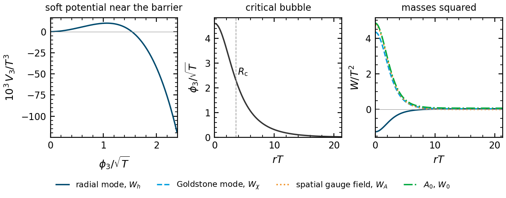
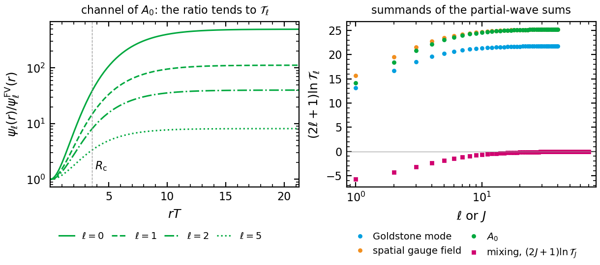
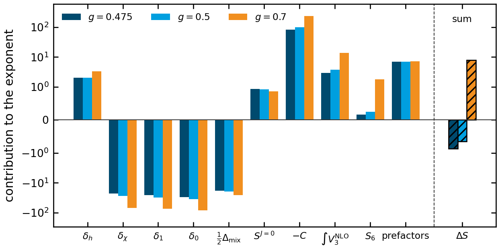

.. _algorithm-three-dimensional-rate:

The nucleation rate in the three-dimensional effective theory
=============================================================

.. warning::

   This page describes the three-dimensional rate as it is used in arXiv:XXXX.XXXXX. The
   documentation is still largely LLM-written and might contain wrong statements which have not
   been checked in detail. These notes will be restructured, checked, and updated in the future
   version 3 of TransitionListener.

For a transition whose barrier is generated by loops, the four-dimensional potential with
daisy resummation (:doc:`the_effective_potential`) does not separate the scales that make the
barrier, and its rate depends strongly on the renormalisation scale. In the classically
conformal :math:`U(1)` the exponent of the four-dimensional rate with the couplings fixed at the
vacuum scale lies about 30 above the next-to-leading-order exponent at percolation, so that the
two rates differ by about thirteen orders of magnitude. The effective theory of the hot plasma
in three dimensions, obtained by dimensional reduction [Kajantie:1995dw]_, organises the
computation as a systematic expansion and removes the leading part of this dependence.
TransitionListener can take the rate from this theory, at leading order (LO) or with its
next-to-leading-order (NLO) correction.

Two models ship with it: ``models/TL_conformal_u1_fermions_3d.py``, the classically conformal
:math:`U(1)` gauge theory with a complex scalar and two Weyl fermions of opposite charge, and
``models/TL_conformal_u1_no_fermions_3d.py``, its special case without the fermions. The
fermions carry gauge charge, so the model with fermions at Yukawa coupling :math:`y = 0` is not
the model without them. Each extends its four-dimensional parent: the phases, the
thermodynamics and the spectrum are those of the parent, and the percolation integrals use the
three-dimensional rate in place of the four-dimensional bounce, which is not solved.

Separation of scales
--------------------

At a temperature :math:`T` every bosonic field decomposes into Matsubara modes with the
frequencies :math:`2\pi n T`. The modes with :math:`n \neq 0` have energies of at least
:math:`2\pi T`, the hard scale. The static modes, :math:`n = 0`, acquire thermal masses of order
:math:`gT`, the soft scale, through their interactions with the plasma, and a critical bubble has
a radius of order :math:`1/gT`. On the scale of the bubble the non-static modes are short-lived
fluctuations. Their effect does not depend on the bubble: they shift the parameters of the soft
fields, so they can be integrated out before the bubble is computed. The static modes remain, with
these shifted parameters, and form a theory in three spatial dimensions in which the bubble and
its fluctuations are computed.

The effective theory and its matching
-------------------------------------

The effective theory contains the static modes of the complex scalar :math:`\Phi`, of the
spatial gauge field :math:`A_i` and of the time component :math:`A_0`, with the Lagrangian, in the
conventions of DRalgo [Ekstedt:2022bff]_,

.. math::

   \mathcal{L}_3 = \tfrac{1}{4} F_{ij}F_{ij} + |D_i\Phi|^2 + m_3^2|\Phi|^2 + \lambda_3|\Phi|^4
   + \tfrac{1}{2} (\partial_i A_0)^2 + \tfrac{1}{2} m_\mathrm{D}^2 A_0^2
   + \tfrac{1}{2}\lambda_\mathrm{VL} A_0^2|\Phi|^2 + \tfrac{1}{4!}\lambda_\mathrm{VLL}A_0^4 .

Its fields are those of the four-dimensional theory divided by :math:`\sqrt{T}`, and
:math:`F_{ij}` is the field strength of :math:`A_i`. The coupling :math:`\lambda_\mathrm{VL}` couples
:math:`A_0` to the scalar and :math:`\lambda_\mathrm{VLL}` is the quartic coupling of :math:`A_0`,
which enters only the two-loop potential. The plasma
screens the electric field over the length :math:`1/m_\mathrm{D}`, the Debye mass, while the
magnetic field stays unscreened at this order, so :math:`A_i` has no mass term.

The parameters follow from those of the four-dimensional theory by matching: both theories must
have the same static correlation functions at distances large compared with :math:`1/2\pi T`. The
matching relations are expansions in the four-dimensional couplings, renormalised at the
matching scale :math:`\mu_4`. The loops of the hard modes leave the logarithm
:math:`L_\mathrm{b} = 2\ln(\mu_4 \mathrm{e}^{\gamma_\mathrm{E}}/4\pi T)` in them, and the default
:math:`\mu_4 = 4\pi\mathrm{e}^{-\gamma_\mathrm{E}}T \simeq 7.06\,T` sets it to zero. The fermions
of the model with fermions leave the corresponding :math:`L_\mathrm{f} = L_\mathrm{b} + 4\ln 2`.

The input of the computation is the gauge coupling :math:`g` at the scale :math:`\mu_0` at which
the quartic coupling vanishes, :math:`\lambda(\mu_0) = 0`, with :math:`\mu_0` fixed by the vacuum
expectation value :math:`v` (``input_scheme = "zero_quartic"``). At every temperature at which the
rate is needed the couplings are run at one loop from :math:`\mu_0` to :math:`\mu_4`. Since
:math:`T \ll \mu_0` at the temperatures of a supercooled transition, the running drives
:math:`\lambda(\mu_4)` negative.

Matching at leading order
~~~~~~~~~~~~~~~~~~~~~~~~~

At leading order (LO) the relations of the model without fermions are [Christiansen:2025xhv]_

.. math::

   g_3^2 = g^2 T, \qquad
   \lambda_3 = \lambda T + \frac{g^4T}{16\pi^2}\left(2 - 3L_\mathrm{b}\right), \qquad
   m_3^2 = \frac{T^2}{12}\left(3g^2 + 4\lambda\right), \qquad
   m_\mathrm{D}^2 = \frac{g^2T^2}{3}, \qquad
   \lambda_\mathrm{VL} = 2g^2T,

with :math:`g` and :math:`\lambda` at :math:`\mu_4`. The term :math:`g^4` of :math:`\lambda_3` is a
one-loop term. It is kept at LO because its part :math:`-3g^4L_\mathrm{b}T/16\pi^2` cancels the
running of :math:`\lambda(\mu_4)` with :math:`\mu_4`, which in this model is driven by :math:`g^4`.
The thermal masses :math:`m_3^2` and :math:`m_\mathrm{D}^2` are themselves one-loop quantities: the
model is classically conformal, so the scalar has no mass term at tree level, and
:math:`A_0` never has one.

Matching at next-to-leading order
~~~~~~~~~~~~~~~~~~~~~~~~~~~~~~~~~

With the LO relations the action still depends on the matching scale, because the dependence of
:math:`g(\mu_4)` and :math:`\lambda(\mu_4)` on :math:`\mu_4` is not cancelled in :math:`m_3^2`,
:math:`m_\mathrm{D}^2` and :math:`g_3^2`. The next-to-leading-order (NLO) relations add to every
parameter its first correction from the hard modes, suppressed against the LO term by
:math:`g^2/16\pi^2`. This is a different number of loops for different parameters. The couplings
:math:`g_3^2` and :math:`\lambda_\mathrm{VL}` and the term :math:`\lambda T` of :math:`\lambda_3`
start at tree level, so their first correction is a one-loop diagram of the hard modes. The thermal
masses :math:`m_3^2` and :math:`m_\mathrm{D}^2` start at one loop, at order :math:`g^2T^2`, so their
first correction, of order :math:`g^4T^2/16\pi^2`, is a two-loop diagram. The two-loop part of a
thermal mass is therefore of the same relative size as the one-loop part of a coupling. For the
model without fermions the NLO relations of the couplings and of the Debye mass are
[Christiansen:2025xhv]_

.. math::

   g_3^2 = g^2T\left(1 - \frac{g^2 L_\mathrm{b}}{48\pi^2}\right), \qquad
   \lambda_\mathrm{VL} = 2g^2T + \frac{\lambda g^2T}{\pi^2} + \frac{g^4T}{24\pi^2}\left(4 - L_\mathrm{b}\right),

.. math::

   \lambda_3 = \lambda T + \frac{T}{16\pi^2}\left[g^4\left(2 - 3L_\mathrm{b}\right) + 6g^2\lambda L_\mathrm{b}
   - 10\lambda^2 L_\mathrm{b}\right],

.. math::

   m_\mathrm{D}^2 = \frac{g^2T^2}{3} + \frac{g^2T^2}{144\pi^2}\left[12\lambda + g^2\left(7 - L_\mathrm{b}\right)\right],

and that of the scalar mass is

.. math::

   m_3^2 = \frac{T^2}{12}\left(3g^2 + 4\lambda\right) + \frac{T^2}{576\pi^2}\Big[
   12g^2\lambda\big(2 + 12\gamma_\mathrm{E} - 144\ln A_\mathrm{G} - 6L_\mathrm{b}\big)
   + 24\lambda^2\big(L_\mathrm{b} - 6\gamma_\mathrm{E} + 72\ln A_\mathrm{G}\big)
   + g^4\big(69L_\mathrm{b} - 8 - 108\gamma_\mathrm{E} + 1296\ln A_\mathrm{G}\big)\Big] + \delta m_3^2 ,

with :math:`A_\mathrm{G}` the Glaisher constant. The terms with :math:`L_\mathrm{b}` cancel the
dependence of :math:`g(\mu_4)` and :math:`\lambda(\mu_4)` on :math:`\mu_4` to this order. The
relations were generated with DRalgo and agree term by term with those of the appendix of
[Christiansen:2025xhv]_. They are in ``models/dr_conformal_u1_no_fermions_matching.py`` and, for
the model with fermions, ``models/dr_conformal_u1_fermions_matching.py``. The corrections to
:math:`\lambda_3` beyond its LO relation are proportional to :math:`L_\mathrm{b}` and vanish at the
default :math:`\mu_4`. At both orders the bubble is computed with the one-loop :math:`\lambda_3` and
:math:`\lambda_\mathrm{VL}`. The setting ``matching_order`` selects the LO or the NLO relations of
:math:`g_3^2`, :math:`m_3^2` and :math:`m_\mathrm{D}^2`.

The last term of :math:`m_3^2` arises from the running within the effective theory. This theory is
superrenormalisable: its couplings :math:`g_3^2`, :math:`\lambda_3` and :math:`\lambda_\mathrm{VL}`
do not run, and the mass parameter runs only at two loops, with
:math:`\mu_3\,\mathrm{d}m_3^2/\mathrm{d}\mu_3 = (8 g_3^4 - 16 g_3^2\lambda_3 + 16\lambda_3^2 + \lambda_\mathrm{VL}^2)/32\pi^2`
at the renormalisation scale :math:`\mu_3` of the effective theory. The matching fixes
:math:`m_3^2` at :math:`\mu_4`, and integrating this running from :math:`\mu_4` to :math:`\mu_3`
yields

.. math::

   \delta m_3^2 = \frac{1}{32\pi^2}\,\ln\frac{\mu_3}{\mu_4}\,
   \big(8 g_3^4 - 16 g_3^2\lambda_3 + 16\lambda_3^2 + \lambda_\mathrm{VL}^2\big),

evaluated with the LO :math:`g_3^2` and the one-loop :math:`\lambda_3` and
:math:`\lambda_\mathrm{VL}`. Its dependence on :math:`\mu_3` cancels against that of the two-loop
potential of the effective theory [Ekstedt:2021kyx]_ [Christiansen:2025xhv]_ [Kierkla:2025qyz]_,

.. math::

   V_3^\mathrm{NLO} = -\frac{g_3^4\phi_3^2}{8\pi^2}\left[\frac{1}{2} + \ln\frac{\mu_3}{2m_A}\right]
   - \frac{\lambda_\mathrm{VL}^2\phi_3^2}{64\pi^2}\left[\frac{1}{2} + \ln\frac{\mu_3}{2m_{A_0}}\right]
   + \frac{\lambda_\mathrm{VLL}\lambda_\mathrm{VL}\,\phi_3^2}{256\pi^2},

with the masses :math:`m_A` and :math:`m_{A_0}` of the soft potential below. The terms
:math:`g_3^4` and :math:`\lambda_\mathrm{VL}^2` of :math:`\tfrac{1}{2}\delta m_3^2\phi_3^2` cancel the
:math:`\ln\mu_3` of the loops of :math:`A_i` and :math:`A_0` in :math:`V_3^\mathrm{NLO}`. The scalar
terms of :math:`\delta m_3^2` have no counterpart there, because the loops of the scalar are not part
of the soft potential. The dependence on :math:`\mu_3` that they leave is part of the uncertainty
estimate. The scale :math:`\mu_3` is a choice. The three-dimensional models take :math:`\mu_3 = gT`
with the input :math:`g`, close to the soft scale :math:`m_3 \simeq gT/2`, so that the logarithms of
the soft scale stay small.

The soft potential and the critical bubble
------------------------------------------

The critical bubble is a configuration of the scalar field alone. Integrating out the gauge field
at one loop on a constant background :math:`\phi_3` leaves the soft potential
[Christiansen:2025xhv]_ [Puchades-Ibanez:2026ksh]_ [Kierkla:2025qyz]_

.. math::

   V_3 = \tfrac{1}{2} m_3^2\phi_3^2 + \tfrac{1}{4}\lambda_3\phi_3^4
   - \frac{1}{12\pi}\left(2m_A^3 + m_{A_0}^3 - m_\mathrm{D}^3\right),
   \qquad m_A^2 = g_3^2\phi_3^2, \quad m_{A_0}^2 = m_\mathrm{D}^2 + \tfrac{1}{2}\lambda_\mathrm{VL}\phi_3^2 .

In three dimensions a bosonic degree of freedom of mass :math:`m` contributes :math:`-m^3/12\pi`.
The factor two counts the transverse polarisations of :math:`A_i`, and the constant
:math:`m_\mathrm{D}^3` sets :math:`V_3(0) = 0`. The cubic terms of the gauge loops make the barrier.
The gauge loops belong in :math:`V_3` at leading order because near the centre of the bubble the
gauge field is heavier than the scalar. The loops of the scalar itself are not part of
:math:`V_3`, because inside the bubble its masses squared in :math:`V_3` are negative. They enter
through the fluctuation determinants.

The bubble is the solution of
:math:`\phi_3'' + (2/r)\phi_3' = \mathrm{d}V_3/\mathrm{d}\phi_3` that approaches the false vacuum
:math:`\phi_3 = 0` far from its centre, and its action
:math:`S_3/T = 4\pi\int \mathrm{d}r\, r^2 [\tfrac{1}{2}\phi_3'^2 + V_3]` is dimensionless in the
three-dimensional theory. With the parameters matched at NLO it is :math:`S_3^\mathrm{NLO}/T`.
Since :math:`\lambda_3 < 0` the potential is unbounded from below and its broken minimum lies
where the effective theory does not apply. The bubble depends on :math:`V_3` only between the
false vacuum and the field at its centre, which lies inside the range of validity. Once
:math:`\mu_4` and :math:`\mu_3` are fixed in units of :math:`T`, :math:`\mu_0` is the only
dimensionful parameter, so :math:`S_3/T` depends only on the couplings and on :math:`T/\mu_0`.

   The critical bubble of the model without fermions at :math:`g = 0.475`, close to its
   percolation temperature. Left: the soft potential near its barrier. Middle: the profile, with
   :math:`R_\mathrm{c}` the radius at which the field has fallen to half its central value. Right:
   the masses squared of the four single fluctuation channels along the bubble. Far from it each
   tends to its value in the false vacuum.

Fluctuations and the exponent at NLO
------------------------------------

The factor :math:`\mathrm{e}^{-S_3/T}` is the leading term of a saddle-point evaluation of the path
integral of the effective theory around the critical bubble. The next term is the Gaussian
integral over the fluctuations of every field around the bubble. For each field this integral is
a functional determinant of its fluctuation operator, and the bubble enters through the ratio of
this determinant to the same determinant around the false vacuum. All terms of this section are
evaluated on the bubble of the NLO-matched theory, whose action is :math:`S_3^\mathrm{NLO}/T`.
Together with the two-loop potential, the operators of dimension six and the dynamical prefactor
they make up the rate :math:`\Gamma = A_\mathrm{dyn} T^3 \mathrm{e}^{-E}`, with the exponent
[Kierkla:2025qyz]_ [Ekstedt:2021kyx]_ [Bernardo:2026tki]_

.. math::

   E = \frac{S_3^\mathrm{NLO}}{T}
   + \delta_h + \delta_\chi + \delta_1 + \delta_0 + \tfrac{1}{2}\Delta_\mathrm{mix} + S^{J=0} - C
   + 4\pi\int_0^\infty \mathrm{d}r\, r^2\, V_3^\mathrm{NLO}\big(\phi_3(r)\big) + S_6 .

The first term is the action of the bubble. The next five terms are the determinants of the
fluctuations of the radial mode of the scalar (:math:`\delta_h`), of its Goldstone mode
(:math:`\delta_\chi`), of the spatial gauge field (:math:`\delta_1`) and of :math:`A_0`
(:math:`\delta_0`), and the part that the mixing of the Goldstone mode with the gauge field adds
(:math:`\tfrac{1}{2}\Delta_\mathrm{mix}`). :math:`S^{J=0}` treats the fluctuations of total angular
momentum zero, which contain a further zero mode. :math:`C` removes from the determinants the
loops that :math:`V_3` already contains, the integral adds the two-loop potential of the effective
theory, and :math:`S_6` is the action of the operators of dimension six. The subsections below
explain these terms in this order and then relate :math:`E` to the correction :math:`\Delta S` that
the percolation integrals use. Without :math:`S_6`, the expression is eq. (4.20) of
[Kierkla:2025qyz]_, written as an exponent and completed by the mixing and the sector
:math:`J = 0` of [Ekstedt:2021kyx]_ and [Bernardo:2026tki]_.

Fluctuation operators
~~~~~~~~~~~~~~~~~~~~~

Expanding the action of the effective theory to second order around the bubble defines the
fluctuation operators. The computation uses the Feynman--'t Hooft gauge, as [Ekstedt:2021kyx]_
[Kierkla:2025qyz]_ [Kierkla:2026bnm]_. A real fluctuation field then has the operator
:math:`-\nabla^2 + W(r)`, with :math:`W(r)` the mass squared of that field at the value
:math:`\phi_3(r)` of the bubble at the distance :math:`r` from its centre. Far from the bubble
:math:`\phi_3 \to 0`, and :math:`W(r)` tends to the mass squared :math:`W_\mathrm{FV}` of the same
field in the false vacuum. Each field changes the exponent by

.. math::

   \delta = \frac{1}{2}\ln\frac{\det\left[-\nabla^2 + W(r)\right]}{\det\left[-\nabla^2 + W_\mathrm{FV}\right]} .

The fluctuations fall into four single channels and one coupled block. The right panel of the
figure of the bubble above shows the masses squared of the single channels.

- The radial mode of the scalar, with :math:`W_h = \partial^2 V_3/\partial\phi_3^2`. In the false
  vacuum it tends to :math:`m_\mathrm{FV}^2 \equiv \partial^2 V_3/\partial\phi_3^2|_{\phi_3 = 0}`,
  the mass squared of the scalar in the soft potential, which differs from :math:`m_3^2` by the
  loop of :math:`A_0` in :math:`V_3`.
- The Goldstone mode :math:`\chi`, with
  :math:`W_\chi = \phi_3^{-1}\,\partial V_3/\partial\phi_3 + g_3^2\phi_3^2`, which tends to the same
  :math:`m_\mathrm{FV}^2`.
- The three components of :math:`A_i`, each with :math:`W_A = m_A^2`, which vanishes in the false
  vacuum, together with the two ghosts. The ghosts have the same :math:`W_A` and cancel two of the
  three components, so that one channel :math:`\delta_1` with :math:`W_A` remains.
- :math:`A_0`, with :math:`W_0 = m_{A_0}^2`, which tends to :math:`m_\mathrm{D}^2`.
- The mixing of :math:`\chi` with the radial component :math:`A_r` of the gauge field through the
  term :math:`2g_3\phi_3'(r)\,A_r\chi` of the quadratic action. It vanishes in the false vacuum,
  where :math:`\phi_3' = 0`.

The radial channel has one negative eigenvalue :math:`\lambda_-`, whose mode expands or shrinks
the bubble, and three zero modes, which translate it. The zero modes are replaced by an integral
over the position of the bubble, which produces the volume factor of the rate, and :math:`\delta_h`
contains the Jacobian :math:`(S_3^\mathrm{NLO}/2\pi T)^{3/2}` of this replacement.

Determinants from the Gelfand--Yaglom theorem
~~~~~~~~~~~~~~~~~~~~~~~~~~~~~~~~~~~~~~~~~~~~~

Every operator is spherically symmetric, so its eigenfunctions separate into partial waves of
orbital angular momentum :math:`\ell`, each :math:`2\ell+1` times degenerate. The ratio of
determinants does not require the eigenvalues. The Gelfand--Yaglom theorem [Gelfand:1959nq]_
relates it to the solutions of the radial equation at zero eigenvalue. In the partial wave
:math:`\ell`, let :math:`\psi_\ell` be the solution of

.. math::

   \left[-\frac{\mathrm{d}^2}{\mathrm{d}r^2} - \frac{2}{r}\frac{\mathrm{d}}{\mathrm{d}r}
   + \frac{\ell(\ell+1)}{r^2} + W(r)\right]\psi_\ell(r) = 0

that is regular at the origin, :math:`\psi_\ell \to r^\ell` for :math:`r \to 0`, and let
:math:`\psi_\ell^\mathrm{FV}` be the same solution with :math:`W_\mathrm{FV}` in place of
:math:`W(r)`. Both start alike at the origin, and their ratio changes only where :math:`W(r)`
differs from :math:`W_\mathrm{FV}`, inside the bubble (left panel of the figure below). The limit of
this ratio,

.. math::

   \mathcal{T}_\ell = \lim_{r\to\infty}\frac{\psi_\ell(r)}{\psi_\ell^\mathrm{FV}(r)} ,

is the ratio of the determinants restricted to the partial wave :math:`\ell`, and the ratio of the
full determinants is

.. math::

   \ln\frac{\det\left[-\nabla^2 + W(r)\right]}{\det\left[-\nabla^2 + W_\mathrm{FV}\right]}
   = \sum_{\ell=0}^\infty (2\ell+1)\ln\mathcal{T}_\ell .

Each :math:`\mathcal{T}_\ell` is finite, but the sum is not. At large :math:`\ell` the centrifugal
term dominates the radial equation, and an expansion in :math:`1/\ell` (the WKB approximation)
yields :math:`\ln\mathcal{T}_\ell \simeq (2\ell+1)^{-1}\int_0^\infty\mathrm{d}r\,r\,[W(r) - W_\mathrm{FV}]`
[Ekstedt:2023sqc]_. The summand therefore tends to a constant (right panel of the figure below),
and the sum diverges linearly. This leading term is first order in :math:`W - W_\mathrm{FV}`. It is
the one-loop diagram in which the field runs once around a loop with one insertion of
:math:`W - W_\mathrm{FV}`, and its momentum integral diverges in the ultraviolet as in any one-loop
diagram. The divergence is removed in the same scheme as all other loops, dimensional
regularisation with :math:`\overline{\mathrm{MS}}` subtraction. In three dimensions the
dimensionally regularised sum of these leading terms has no pole, so it is finite without a
counterterm, consistent with the absence of one-loop running in the effective theory. BubbleDet
[Ekstedt:2023sqc]_, which computes :math:`\delta_h`, :math:`\delta_\chi`, :math:`\delta_1` and
:math:`\delta_0`, subtracts the WKB approximation from :math:`\ln\mathcal{T}_\ell` in every partial
wave, so that the remaining sum converges, and adds the dimensionally regularised sum of the WKB
terms back.

   The Gelfand--Yaglom method for the bubble above. Left: the ratio of the solutions around the
   bubble and around the false vacuum in the channel of :math:`A_0`, for four partial waves. It
   changes inside the bubble and settles at :math:`\mathcal{T}_\ell` outside. Right: the summands of
   the partial-wave sums. In the single channels they tend to a constant, so the sums must be
   renormalised. The summand of the mixing falls as :math:`(J + 1/2)^{-2}`.

The mixing of the Goldstone mode with the gauge field
~~~~~~~~~~~~~~~~~~~~~~~~~~~~~~~~~~~~~~~~~~~~~~~~~~~~~

In the coupled block the partial waves are labelled by the total angular momentum :math:`J`. The
Goldstone mode has the orbital angular momentum :math:`\ell = J`, and the mixing term couples it to
the two components of :math:`A_i` with :math:`\ell = J \pm 1`. At :math:`J = 0` only the radial
component with :math:`\ell = 1` remains. For each :math:`J` the Gelfand--Yaglom theorem holds for
the coupled radial equations [Ekstedt:2021kyx]_. Let :math:`\Psi_J(r)` be the matrix whose columns
are the three solutions of these equations that are regular at the origin, one for each of the
three components, and let :math:`\Psi_J^{(0)}(r)` be the same matrix with the mixing term switched
off. Then

.. math::

   \mathcal{T}_J = \lim_{r\to\infty}\frac{\det\Psi_J(r)}{\det\Psi_J^{(0)}(r)} .

Without the mixing term the block falls apart into the Goldstone and gauge channels above, so

.. math::

   \Delta_\mathrm{mix} = \sum_{J=0}^\infty (2J+1)\ln\mathcal{T}_J

is the part of the determinant that the mixing adds. The ultraviolet divergence is the same with
and without the mixing term, so this sum converges without renormalisation: its summand falls as
:math:`(J+1/2)^{-2}` (right panel of the figure above). The coupled operator is that of
[Ekstedt:2021kyx]_, derived again from the Lagrangian. BubbleDet treats single channels only, so
TransitionListener solves the coupled equations itself. It sums the waves up to :math:`J = 70` and
adds the remainder of the sum from an expansion of the summand in inverse powers of
:math:`J + 1/2`, fitted to the waves below :math:`J = 70`. At :math:`g = 0.475` the remainder is
about one unit, known to better than 0.1.

The sector of zero angular momentum
~~~~~~~~~~~~~~~~~~~~~~~~~~~~~~~~~~~

At :math:`J = 0` the coupled block has a further zero mode. A global :math:`U(1)` rotation of the
bubble, together with a pure-gauge field, leaves its action unchanged, and in this gauge the ghosts
do not cancel the mode. Left in the determinant, it makes the exponent of the rate depend on the
radius :math:`R` of the numerical domain as :math:`-\tfrac{3}{2}\ln R`. As for the translations,
the mode is replaced by an integral over its collective coordinate, the :math:`U(1)` orientation
[Endo:2017tsz]_ [Ekstedt:2021kyx]_. The Jacobian of this replacement depends on how far the bubble
reaches into the false vacuum. Far from its centre the field is small and obeys the linearised
field equation :math:`\phi_3'' + 2\phi_3'/r = m_\mathrm{FV}^2\phi_3`, so
:math:`\phi_3(r) \to \mathcal{A}\,\mathrm{e}^{-m_\mathrm{FV} r}/r`. The constant :math:`\mathcal{A}`,
the amplitude of the tail of the bubble, is read off from the profile. The sector :math:`J = 0` then
contributes :math:`-\ln 2\pi - \tfrac{1}{2}\ln\big(2\mathcal{A}\,\phi_3(0)\big)` to the exponent
[Bernardo:2026tki]_. This replaces the waves of :math:`J = 0` that the other terms contain: the wave
:math:`\ell = 0` of the Goldstone mode in :math:`\delta_\chi`, one of the three states of the wave
:math:`\ell = 1` of the gauge field in :math:`\delta_1`, and the term :math:`J = 0` of
:math:`\tfrac{1}{2}\Delta_\mathrm{mix}`. In the gauge channel the ghosts at :math:`\ell = 0` are
removed as well [Bernardo:2026tki]_, so that

.. math::

   S^{J=0} = -\ln 2\pi - \tfrac{1}{2}\ln\big(2\mathcal{A}\,\phi_3(0)\big)
   - \tfrac{1}{2}\left(\ln\mathcal{T}_{J=0} + \ln\mathcal{T}_{A,\ell=1} + \ln\mathcal{T}_{\chi,\ell=0}\right)
   + \ln\mathcal{T}_{A,\ell=0} ,

where :math:`\mathcal{T}_{A,\ell}` and :math:`\mathcal{T}_{\chi,\ell}` are the
:math:`\mathcal{T}_\ell` of the channels of the gauge field and of the Goldstone mode, and
:math:`\mathcal{T}_{J=0}` is that of the coupled block. The result does not depend on the size of
the numerical domain.

Loops counted once
~~~~~~~~~~~~~~~~~~

The potential :math:`V_3` contains the loops of :math:`A_i` and :math:`A_0` for a constant
background, which is the leading term of the derivative expansion of their determinants. The
determinants :math:`\delta_1` and :math:`\delta_0` contain the same loops a second time, evaluated on
the bubble itself. The determinants are kept, because the derivative expansion fails in the tail of
the bubble: there the gauge field becomes light, and its wavelength exceeds the scale on which
:math:`\phi_3` varies. To avoid counting these loops twice, the exponent subtracts
[Gould:2021ccf]_ [Kierkla:2025qyz]_ [Kierkla:2026bnm]_

.. math::

   C = -\frac{1}{12\pi}\,4\pi\int_0^\infty\mathrm{d}r\,r^2
   \left[2m_A^3 + m_{A_0}^3 - m_\mathrm{D}^3\right]_{\phi_3 = \phi_3(r)} ,

the cubic terms of :math:`V_3` integrated over the bubble.

The two-loop potential
~~~~~~~~~~~~~~~~~~~~~~

The integral in :math:`E` adds the two-loop potential :math:`V_3^\mathrm{NLO}` of the effective
theory, given with the NLO matching above, over the bubble in the same way. Since the bubble solves
the field equation of the one-loop :math:`V_3`, its action is stationary under a change of the
profile, and the two-loop potential enters as a first-order correction to that action, without a
new bubble. Its dependence on :math:`\mu_3` cancels that of the gauge terms of
:math:`\delta m_3^2`.

The operators of dimension six
~~~~~~~~~~~~~~~~~~~~~~~~~~~~~~

The hard modes also generate operators of dimension six. Two of them do not vanish on the bubble,
:math:`c_6|\Phi|^6` and :math:`c_D(\Phi^\dagger\Phi)(D_i\Phi)^\dagger(D_i\Phi)`. With
:math:`\Phi = \phi_3/\sqrt{2}` and the on-shell coefficients :math:`c_6` and :math:`c_D` of
[Bernardo:2026tki]_ (see also [Bernardo:2025vkz]_), their action on the bubble is

.. math::

   S_6 = 4\pi\int_0^\infty\mathrm{d}r\, r^2\left[\frac{c_6}{8}\,\phi_3^6
   + \frac{c_D}{4}\,\phi_3^2\left(\frac{\mathrm{d}\phi_3}{\mathrm{d}r}\right)^2\right].

As for the two-loop potential, this is a first-order correction on the bubble of :math:`V_3`.
[Bernardo:2026tki]_ also includes the operators in the fluctuation determinants. That part is left
out here and counted in the uncertainty below.

The dynamical prefactor and the correction to the action
~~~~~~~~~~~~~~~~~~~~~~~~~~~~~~~~~~~~~~~~~~~~~~~~~~~~~~~~

The dynamical prefactor describes how the unstable mode of the bubble evolves in real time. The rate
takes Langer's prescription [Langer:1969bc]_ [Affleck:1980ac]_,
:math:`A_\mathrm{dyn} = \sqrt{|\lambda_-|}/2\pi`, with the negative eigenvalue :math:`\lambda_-` of
the radial channel from BubbleDet. Langer's rate is reproduced on the lattice for a fully
thermalised metastable phase [Hirvonen:2025hqn]_, whereas real-time simulations can find rates
lower by about a factor of four [Gould:2026mtl]_.

The percolation integrals use the rate in the form
:math:`T^4 (S_\mathrm{tot}/2\pi)^{3/2}\mathrm{e}^{-S_\mathrm{tot}}`. Equating the two forms defines
the correction to the action,

.. math::

   \Delta S = E - \frac{S_3^\mathrm{NLO}}{T} - \ln\frac{A_\mathrm{dyn}}{T}
   + \frac{3}{2}\ln\frac{S_\mathrm{tot}}{2\pi}, \qquad S_\mathrm{tot} = \frac{S_3^\mathrm{NLO}}{T} + \Delta S ,

which is solved by iteration, since :math:`S_\mathrm{tot}` appears on both sides. The last term
undoes the Jacobian by which this form multiplies the rate, since :math:`\delta_h` already contains
it, with :math:`S_3^\mathrm{NLO}/T` in place of :math:`S_\mathrm{tot}`.

   The terms of :math:`\Delta S` at three couplings of the model without fermions, each close to
   its percolation temperature. "Prefactors" collects
   :math:`-\ln(A_\mathrm{dyn}/T) + \tfrac{3}{2}\ln(S_\mathrm{tot}/2\pi)`. The hatched bars are the sum.
   The vertical axis is logarithmic above 1 and below -1 and linear in between.

The determinants and :math:`-C` are large and of opposite sign, and their sum is of order one where
the conformal model fits the pulsar timing data, because :math:`C` removes what :math:`V_3` already
contains. The difference between the exponents at NLO and at LO is therefore dominated by the NLO
matching, mostly by the shift of :math:`m_3^2`.

Uncertainties and validity
--------------------------

The rate is uncertain through the scales :math:`\mu_4` and :math:`\mu_3`, which are varied by a
factor of two, through the operators of dimension six in the determinants, which are left out
and estimated by the shift :math:`S_6` that the operators cause on the bubble, and through the
next order, estimated by shifting the exponent by :math:`\pm x_3|S_\mathrm{NLO} - S_\mathrm{LO}|`
with the loop expansion parameter :math:`x_3 = g_3^2/(\pi m_3)` of the effective theory.

The theory applies where the scales are separated. A run reports at the percolation temperature
:math:`x_3` as ``DIAG:eft3d_expansion_3d``, the heaviest mode kept in the three-dimensional theory
over :math:`2\pi T` as ``DIAG:eft3d_hard``, and :math:`S_6` over :math:`S_3^\mathrm{LO}/T` as
``DIAG:eft3d_dim6``. ``WARNING:eft3d_outside_validity`` marks a run where one of them exceeds its
threshold, or could not be evaluated: 1 for :math:`x_3` with the correction and 0.3 without it, 1
for the heaviest mode and 0.05 for the shift. The Debye mass over :math:`2\pi T`, above 0.5, and a
fermion mass over :math:`\pi T`, above 1, set the warning as well. Above :math:`g = 0.85` a run
with the correction also warns that a change of :math:`\mu_3` by a factor of two moves the
exponent by more than two per cent.

Implementation
--------------

:py:mod:`transitionlistener.eft_rate.abelian_higgs_3d` holds the physics of the terms above,
:py:mod:`transitionlistener.eft_rate.one_field_rate_3d` the mix-in ``ThreeDimensionalRate`` that turns a model with
a three-dimensional potential into a model with this rate, and
:py:mod:`transitionlistener.eft_rate.nlo_tables` the tables of the correction.

The leading-order action from one table
~~~~~~~~~~~~~~~~~~~~~~~~~~~~~~~~~~~~~~~

At leading order the bubble is the bounce of a single radial field :math:`\phi` with a canonical
kinetic term in the potential

.. math::

   V(\phi) = \tfrac{1}{2} m_3^2\phi^2 + \tfrac{1}{4}\lambda_3\phi^4
   - \frac{\kappa}{12\pi}\Big[2\,(M^2\phi^2)^{3/2} + (m_\mathrm{D}^2 + c\,M^2\phi^2)^{3/2} - m_\mathrm{D}^3\Big].

Here :math:`M^2\phi^2` is the mass squared of the gauge bosons, :math:`m_\mathrm{D}^2 + c\,M^2\phi^2`
that of their temporal modes, and :math:`\kappa` counts the gauge bosons. The number :math:`c`
measures the coupling of :math:`A_0^2\phi^2` relative to its LO value: :math:`c = 1` when
:math:`\lambda_\mathrm{VL} = 2g_3^2`. For the :math:`U(1)` of the conformal models, :math:`\kappa = 1`,
:math:`M^2 = g_3^2` and :math:`c = \lambda_\mathrm{VL}/(2g_3^2)`, and :math:`V` is the soft potential
:math:`V_3` above. With the one-loop :math:`\lambda_\mathrm{VL}` of the NLO matching, :math:`c`
differs from 1 by less than one per cent for :math:`g \leq 0.6`. Only at :math:`g \gtrsim 0.8` and
temperatures far below :math:`\mu_0` does it fall to about 0.95.

The action depends on the five parameters :math:`m_3^2`, :math:`\lambda_3`, :math:`M^2`,
:math:`m_\mathrm{D}` and :math:`c` (and on :math:`\kappa`) only through three combinations. To see
this, write the field and the radius in units set by the gauge sector,

.. math::

   \phi = \frac{m_\mathrm{D}}{M}\,f, \qquad r = \frac{\rho}{\sqrt{\kappa M^2 m_\mathrm{D}}} .

In the dimensionless field :math:`f` and radius :math:`\rho` the potential becomes
:math:`V = \kappa\, m_\mathrm{D}^3\, U(f)`, with

.. math::

   U(f) = f^2\left[\frac{A - h(f)}{2} + \frac{B}{4} f^2\right], \qquad
   h(f) = \frac{2f + c\,\big(w + 1/(1+w)\big)}{6\pi}, \qquad w = \sqrt{1 + c f^2},

   A = \frac{m_3^2}{\kappa M^2 m_\mathrm{D}}, \qquad
   B = \frac{\lambda_3 m_\mathrm{D}}{\kappa M^4} .

The term :math:`-f^2 h(f)/2` is the gauge loops in these units. The action of the bubble is then

.. math::

   \frac{S_3}{T} = \kappa^{-1/2}\Big(\frac{m_\mathrm{D}}{M^2}\Big)^{3/2} F(A, B, c),

where :math:`F(A, B, c) = 4\pi\int\mathrm{d}\rho\,\rho^2\,[\tfrac{1}{2}f'^2 + U(f)]` is the action of
the bounce :math:`f(\rho)` of :math:`U`. The same idea is familiar from the potential with a single
cubic term, whose action depends on one combination of its parameters [Dine:1992wr]_. The
three-parameter form here, which includes the temporal modes, and its table are TransitionListener's
own.

For a given point of a model the four parameters of the effective theory change with temperature,
so each temperature corresponds to its own value of :math:`(A, B, c)`, and a point traces a curve
through the table as :math:`T` falls. The fermions of the conformal model with fermions enter only
through the matching, which sets :math:`m_3^2`, :math:`\lambda_3`, :math:`g_3^2` and
:math:`m_\mathrm{D}^2`. One table of :math:`F` therefore serves the conformal model without fermions
and the conformal model with fermions, at every :math:`v`, :math:`g` and :math:`y` and every
temperature. An :math:`SU(2)` doublet with degenerate gauge bosons has :math:`\kappa = 3`,
:math:`M^2 = g_3^2/4` and the same :math:`F`.

:math:`F` exists between two edges. The origin is a minimum only for
:math:`A > c/(4\pi)`; at this edge the barrier vanishes and :math:`F \propto (A - c/4\pi)^{3/2}`.
The potential becomes negative somewhere only below :math:`B_\mathrm{E}(A, c)`, the value of
:math:`B` at which the two minima are degenerate; at this edge :math:`F` diverges as
:math:`(1 - B/B_\mathrm{E})^{-2}`. Both edges are computed exactly, by a Newton iteration for
:math:`B_\mathrm{E}`. In the variables

.. math::

   s = \ln(A - c/4\pi), \qquad \tau = -\ln(1 - B/B_\mathrm{E}),

both edges lie at infinity and :math:`\ln F` is close to linear. The table holds :math:`\ln F` on
a uniform grid with :math:`s` from :math:`-8` to 5 and :math:`\tau` from :math:`-8` to 6.5 in steps of
0.1, and :math:`c` from 0.94 to 1.06 in steps of 0.02, 133882 bounces in all, each solved with the
bounce solver of the leading-order rate. A quintic spline through these values is continuous in
its first four derivatives, so :math:`\mathrm{d}S_3/\mathrm{d}T`, which sets :math:`(\beta/H)_{S_3}`,
has no kinks at the nodes.

At random points of :math:`(s, \tau, c)` between the nodes the spline agrees with direct bounces
to :math:`10^{-6}` in :math:`\ln F`. For :math:`s > -6` and :math:`\tau > -6` the interpolation
error is of order :math:`10^{-8}`. Along the temperature lines of the conformal models, for
:math:`S_3/T` from a few to several thousand, :math:`\ln(S_3/T)` agrees with direct bounces to
:math:`10^{-8}`, the precision of the direct bounces themselves, and
:math:`\mathrm{d}\ln S_3/\mathrm{d}\ln T` to :math:`10^{-7}`. For :math:`s < -6` the direct
bounces scatter by up to :math:`10^{-4}` in :math:`\ln F`. The conformal models reach this corner
only at :math:`S_3/T < 0.2`, where no rate is evaluated. Closer to the edges than the table
reaches, or for :math:`c` outside :math:`[0.94, 1.06]`, the bounce is solved directly. The table
is ``tab_data/lo_bounce_tables/lo_bounce_table.npz``, its module
:py:mod:`transitionlistener.eft_rate.abelian_lo_bounce_table`, and the command
``tl-bounce-table`` rebuilds it in about 47 core minutes.

The NLO correction from tables
~~~~~~~~~~~~~~~~~~~~~~~~~~~~~~

:math:`\Delta S` takes seconds to tens of seconds per temperature, so it is not computed during a
run. Each model ships a table of :math:`\Delta S_0/(S_3^\mathrm{LO}/T)`, where :math:`\Delta S_0` is
:math:`\Delta S` with :math:`S_6` left out of :math:`E`, as a function of
:math:`S_3^\mathrm{LO}/T`, at 23 values from 5 to 350. At fixed couplings this ratio holds for
every :math:`v`, because :math:`S_3/T` depends on :math:`T/\mu_0` only, and between the coupling
points of the table it is interpolated. The model without fermions has 30 points from
:math:`g = 0.38` to 1, the model with fermions 283 points in :math:`(g, y)` with :math:`g` from
0.38 to 1 and :math:`y` from 0 to 1. Each table holds :math:`\mu_4 = 7.0553\,T`, halved and
doubled. Between the values of :math:`S_3^\mathrm{LO}/T` the ratio is interpolated by a quintic spline
in :math:`\ln S_3^\mathrm{LO}/T`; between coupling points by a cubic spline in :math:`g`
for the model without fermions and by a Clough--Tocher interpolant in :math:`(g, y)` for the model
with fermions. The tables are in ``src/transitionlistener/tab_data/nlo_grids``.

:math:`S_6` is stored in the same way, as :math:`S_6/(S_3^\mathrm{LO}/T)` on the same nodes,
because the switch ``include_dim6`` decides at run time whether it enters. With it,
:math:`\Delta S` is not :math:`\Delta S_0 + S_6`: :math:`S_6` enters :math:`E`, and the
prefactor :math:`\tfrac{3}{2}\ln(S_\mathrm{tot}/2\pi)` depends on :math:`\Delta S` itself, so the run
solves

.. math::

   \Delta S = \Delta S_0 + S_6 + \tfrac{3}{2}\ln\frac{S_3^\mathrm{LO}/T + \Delta S}{S_3^\mathrm{LO}/T + \Delta S_0}

by fixed-point iteration, which converges in a few steps because the right-hand side changes by
:math:`\tfrac{3}{2}/(S_3/T)` per unit of :math:`\Delta S`.

The interpolation was compared with :math:`\Delta S` computed directly at the same couplings and
temperatures. For the model without fermions, at 300 random couplings, twelve values of
:math:`S_3^\mathrm{LO}/T` from 10 to 340 and the three values of :math:`\mu_4`, and at the midpoints
between the tabulated values of :math:`S_3^\mathrm{LO}/T`, the difference in :math:`\Delta S` has a
median of :math:`2\times10^{-5}` and a maximum of :math:`7\times10^{-3}`. For
:math:`S_3^\mathrm{LO}/T \geq 40`, where every percolation temperature lies, it shifts the temperature
at which the rate takes a given value by at most :math:`1.2\times10^{-5}` in :math:`\ln T`. For the
model with fermions, at 60 random :math:`(g, y)` and six values of :math:`S_3^\mathrm{LO}/T` from 20
to 300, the median difference is :math:`3\times10^{-3}` and the shift at most :math:`4\times10^{-3}`
in :math:`\ln T`. Here the interpolation between the coupling points sets the precision. Both are
far below the change of the percolation temperature when :math:`\mu_4` is halved or doubled, about
one per cent.

The single channels are computed with BubbleDet [Ekstedt:2023sqc]_, the coupled block of the
mixing with the compiled solver
:py:func:`transitionlistener.eft_rate.abelian_determinants.log_gy_mixed`.

Above :math:`S_3/T = 600` the exponent is saturated smoothly towards 1200, where the rate is zero for
every purpose of the percolation integrals, so that a temperature without a barrier does not
stop a run.

Settings
--------

The keys belong to ``nucleationConf``. A ``Nucleation`` block of a configuration file sets them
too, after the model has set its own. ``examples/example_point_3d.yaml`` lists them with the other
switches of the uncertainty study.

.. list-table::
   :widths: 30 70
   :header-rows: 1

   * - Key
     - Default of the three-dimensional models
   * - ``rate_mode``
     - ``"model"``, the three-dimensional rate. ``"S3overT_4D"``, the default of every other
       model, is the four-dimensional rate of the parent model.
   * - ``include_determinants``
     - ``True``, the NLO correction from the shipped table. ``False`` is the leading-order rate.
   * - ``include_dim6``
     - ``True``, :math:`S_6`, which the table stores apart from the rest of :math:`\Delta S`.
   * - ``input_scheme``, ``mu3_choice``
     - ``"zero_quartic"`` and ``"gT"``, the conventions of the shipped tables. Every other model
       has ``"CW"`` and ``"g3sq"``.
   * - ``temporal_coupling``
     - ``"h3"``, the matched coupling :math:`\lambda_\mathrm{VL}` in the mass of :math:`A_0`.
       ``"2g3sq"`` is its leading-order value :math:`2 g_3^2`.
   * - ``matching_order``, ``mu4_over_T``
     - ``"NLO"`` and ``7.0553``. The shipped tables also hold ``mu4_over_T`` halved and doubled.
   * - ``nlo_grid_file``
     - ``None``, the shipped table. The path of a table of your own, built as below, replaces it.

A run whose ``input_scheme``, ``mu3_choice``, ``temporal_coupling`` or ``matching_order``
differ from those of the table, or whose ``mu4_over_T`` is not one the table holds, is refused,
because the table would not apply to it.

Runs outside the shipped table
------------------------------

A run that asks the table for something it does not hold stops with ``NLOGridError``. Three
cases raise it:

* a coupling point outside the points of the table, at the first temperature asked for,
* a temperature whose :math:`S_3^\mathrm{LO}/T` lies outside the range of the table at that
  coupling point, unless the rate at the hot end of the table is already below :math:`H^4` by a
  factor :math:`\mathrm{e}^{20}`, or at the cold end above it by that factor, so that the
  temperatures beyond do not affect percolation,
* conventions that differ from those of the table, as above.

Nothing is extrapolated. To run such a point, build a table for it. The fluctuation determinants
need BubbleDet, which a run on a shipped table does not, so install it with
``pip install 'transitionlistener[nlo]'``. Then compute one table for each coupling point and
collect them in a grid file, for example for the model without fermions below :math:`g = 0.38`

.. code-block:: bash

   for g in 0.34 0.36 0.38; do
       tl-nlo-table build --model-file models/TL_conformal_u1_no_fermions_3d.py --param g=$g \
           --out-stem nodes/g$g
   done
   tl-nlo-table assemble --nodes "nodes/*.json" --out my_grid.npz

``build`` takes the model file and its parameters, one ``--param name=value`` each (``g`` and ``y`` for
the model with fermions). Any model with a three-dimensional rate that supplies what the tables need
of it can be used. So far these are the two conformal models. Its options
``--input-scheme``, ``--mu3-choice``, ``--temporal-coupling``, ``--mu4-over-T`` and
``--mu4-factors`` set the conventions of the table, and ``--S-nodes`` the values of
:math:`S_3^\mathrm{LO}/T`, which ``assemble`` takes as well. Each point writes one file per entry
of ``--mu4-factors``, and a build that stops can be run again to resume it. One point at the
default 23 values of :math:`S_3^\mathrm{LO}/T` takes about seven minutes on one core. The points
have to enclose the coupling point of the run, with at least three values of :math:`g` for the
model without fermions and a triangle around :math:`(g, y)` for the model with fermions.
``assemble`` writes the grid file and prints the error of interpolating each point from the
others. ``tl-nlo-table info my_grid.npz`` shows its range. Point the run at it with

.. code-block:: yaml

   Nucleation:
     nlo_grid_file: my_grid.npz

or with ``nucleationConf.nlo_grid_file`` in Python.

The thermodynamics of the run
-----------------------------

The strength :math:`\alpha` and the sound speed still come from the four-dimensional potential of
the parent model. In a strongly supercooled broken phase its daisy term makes the sound speed
squared tend to 1/2 instead of 1/3. ``WARNING:daisy_outside_validity`` marks a run where the daisy
term is used outside its range of validity.

References
----------

.. [Kajantie:1995dw] K. Kajantie, M. Laine, K. Rummukainen and M. Shaposhnikov, *Generic rules for
   high temperature dimensional reduction and their application to the Standard Model*, Nucl. Phys.
   B 458, arXiv:hep-ph/9508379.
.. [Ekstedt:2022bff] A. Ekstedt, P. Schicho and T. V. I. Tenkanen, *DRalgo: a package for effective
   field theory approach for thermal phase transitions*, Comput. Phys. Commun. 288,
   arXiv:2205.08815.
.. [Christiansen:2025xhv] M. Christiansen, E. Madge, C. Puchades-Ibáñez et al., *Beyond the daisy
   chain: running and the 3D EFT view of supercooled phase transitions*, arXiv:2511.02910.
.. [Puchades-Ibanez:2026ksh] C. Puchades-Ibáñez and P. Schwaller, *The devil in the transition: NLO
   nucleation and the particle physics behind the PTA signal*, arXiv:2609.12098.
.. [Kierkla:2025qyz] M. Kierkla, P. Schicho, B. Świeżewska, T. V. I. Tenkanen et al.,
   *Finite-temperature bubble nucleation with shifting scale hierarchies*, arXiv:2503.13597.
.. [Ekstedt:2021kyx] A. Ekstedt, *Higher-order corrections to the bubble-nucleation rate at finite
   temperature*, Eur. Phys. J. C 82, arXiv:2104.11804.
.. [Bernardo:2026tki] F. Bernardo, M. Kierkla, N. Leister, P. Schicho, P. Schwaller et al., *Bubble
   nucleation with thermal higher-dimensional operators*, arXiv:2610.12284.
.. [Bernardo:2025vkz] F. Bernardo, P. Klose, P. Schicho and T. V. I. Tenkanen, *Higher-dimensional
   operators at finite temperature affect gravitational-wave predictions*, arXiv:2503.18904.
.. [Gould:2021ccf] O. Gould and J. Hirvonen, *Effective field theory approach to thermal bubble
   nucleation*, Phys. Rev. D 104, arXiv:2108.04377.
.. [Gelfand:1959nq] I. M. Gelfand and A. M. Yaglom, *Integration in functional spaces and its
   applications in quantum physics*, J. Math. Phys. 1.
.. [Dine:1992wr] M. Dine, R. G. Leigh, P. Huet, A. Linde and D. Linde, *Towards the theory of
   cosmological phase transitions*, Phys. Rev. D 46 (1992) 550, arXiv:hep-ph/9203203.
.. [Endo:2017tsz] M. Endo, T. Moroi, M. M. Nojiri and Y. Shoji, *False vacuum decay in gauge
   theory*, JHEP 11 (2017) 074, arXiv:1704.03492.
.. [Kierkla:2026bnm] M. Kierkla, M. Lewicki, P. Schicho, D. Schmitt and B. Świeżewska,
   *Theoretical uncertainties in reconstructing model parameters with gravitational waves from
   supercooled phase transitions*, arXiv:2607.18233.
.. [Affleck:1980ac] I. Affleck, *Quantum statistical metastability*, Phys. Rev. Lett. 46, 388.
.. [Hirvonen:2025hqn] J. Hirvonen and O. Gould, *Langer's nucleation rate reproduced on the
   lattice*, Phys. Rev. Lett. 136, 081601, arXiv:2505.22732.
.. [Langer:1969bc] J. S. Langer, *Statistical theory of the decay of metastable states*, Annals
   Phys. 54.
.. [Gould:2026mtl] O. Gould, J. Hirvonen, A. Shkerin and S. Sibiryakov, *Dynamics of nucleation in
   thermal phase transitions*, arXiv:2608.00169.
.. [Ekstedt:2023sqc] A. Ekstedt, O. Gould and J. Hirvonen, *BubbleDet: a Python package to compute
   functional determinants for bubble nucleation*, JHEP 12 (2023), arXiv:2308.15652.
