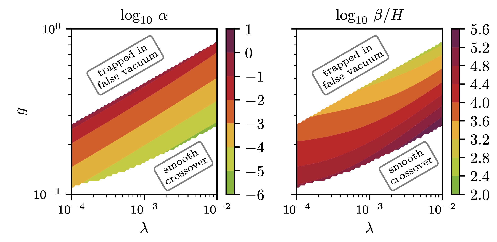
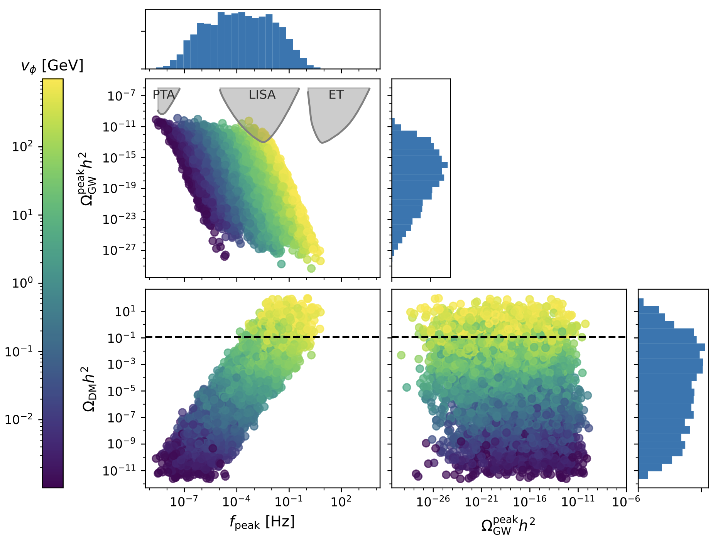
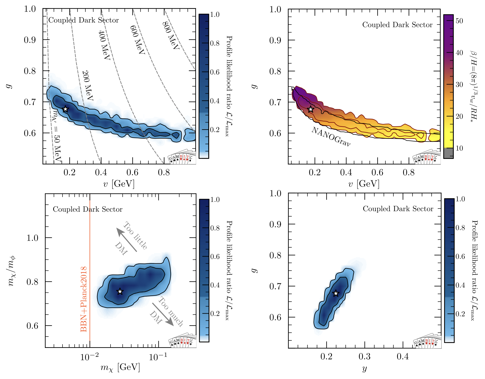
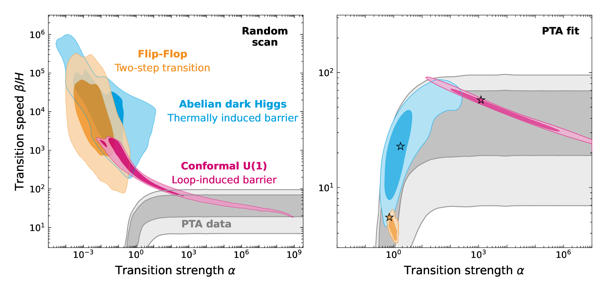
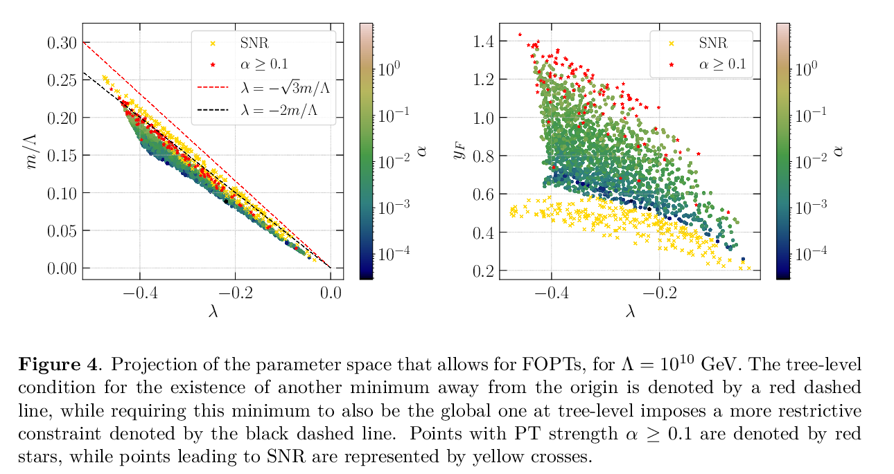
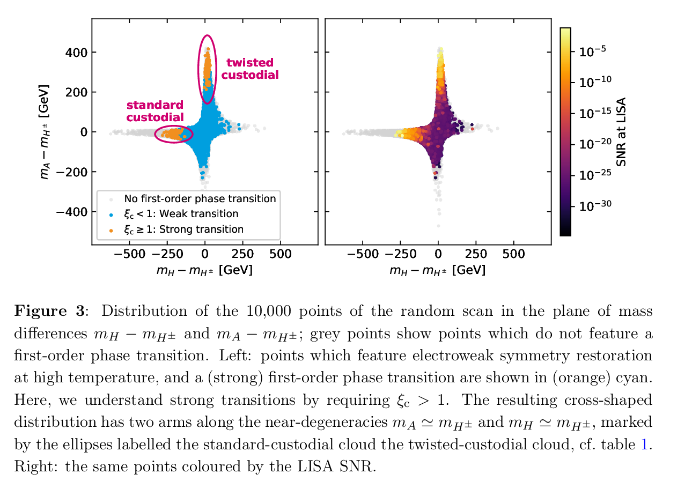

# Works that used TransitionListener

TransitionListener has been used in the studies below, each with one figure it produced. The
first four are from the group that develops it and the last two are from elsewhere.

1. [Turn up the volume: listening to phase transitions in hot dark sectors](https://inspirehep.net/literature/1921562)  
   arXiv: [2109.06208](https://arxiv.org/abs/2109.06208), *JCAP* **02** (2022) 014.  
   This work introduced the original TransitionListener workflow for a dark
   Abelian Higgs model and used it to compute phase-transition dynamics,
   dilution effects, and the resulting gravitational wave signal for hot dark
   sectors.

   

     
   

2. [Hunting WIMPs with LISA: correlating dark matter and gravitational wave signals](https://inspirehep.net/literature/2721943)  
   arXiv: [2311.06346](https://arxiv.org/abs/2311.06346), *JCAP* **05** (2024) 065.  
   Here TransitionListener was used to map the phase-transition and
   gravitational wave predictions of a dark $U(1)^\prime$ model onto the
   relic-density requirement, exposing the correlation between dark matter
   freeze-out and the milli-Hertz gravitational wave signal.

   

     
   

3. [Sub-GeV dark matter and nano-Hertz gravitational waves from a classically conformal dark sector](https://inspirehep.net/literature/2895297)  
   arXiv: [2502.19478](https://arxiv.org/abs/2502.19478), *JCAP* **08** (2025) 062.  
   In this project TransitionListener was applied to a classically conformal
   dark $U(1)^\prime$ model in order to identify parameter regions that
   simultaneously yield a PTA-scale gravitational wave signal, the observed
   dark matter abundance, and consistency with laboratory and cosmological
   constraints.

   

     
   

4. [Tuning the violins: dark sector phase transition models for the PTA signal](https://inspirehep.net/literature/3118127)  
   arXiv: [2602.09092](https://arxiv.org/abs/2602.09092).  
   This study
   used TransitionListener random scans and its UltraNest/PTA-likelihood
   interface to compare several dark-sector model classes and quantify how much
   tuning is required to explain the PTA signal.

   

     
   

   The left panel shows generic model predictions from TransitionListener random scans and the
   right panel the regions the PTA data favours, obtained with the UltraNest backend.

5. [Gravitational Waves from Dimension-6 Assisted Peccei-Quinn Phase Transitions](https://inspirehep.net/arxiv/2608.13692)  
   arXiv: [2608.13692](https://arxiv.org/abs/2608.13692).  
   The first study from outside the project to use TransitionListener. A
   dimension-6 operator added to the Peccei-Quinn effective potential of the
   minimal KSVZ axion model makes the symmetry-breaking transition first order,
   and TransitionListener was used for the refined scan of the parameter space
   where the resulting gravitational wave signal is observable.

   

     
   

6. [When the HL-LHC is blind, LISA is deaf (but not vice versa): 2HDM collider-cosmology synergies](https://inspirehep.net/arxiv/2608.23679)  
   arXiv: [2608.23679](https://arxiv.org/abs/2608.23679).  
   Here TransitionListener supplied the phase-transition and gravitational wave
   predictions for a scan of the two-Higgs-doublet model, which were then set
   against what the high-luminosity LHC can exclude in the same parameter
   points, so that each experiment's reach is measured on the region the other
   cannot cover.

   

     
   

