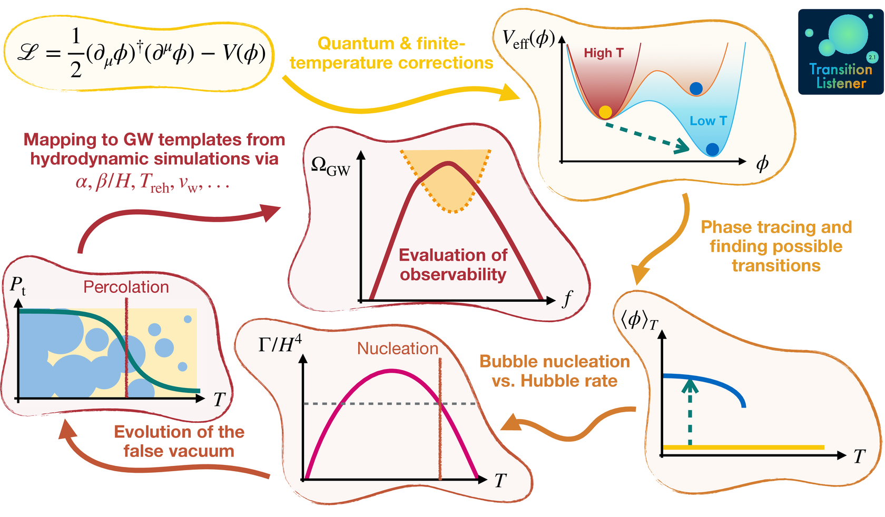
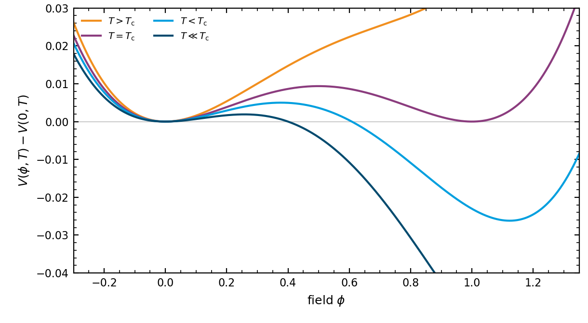
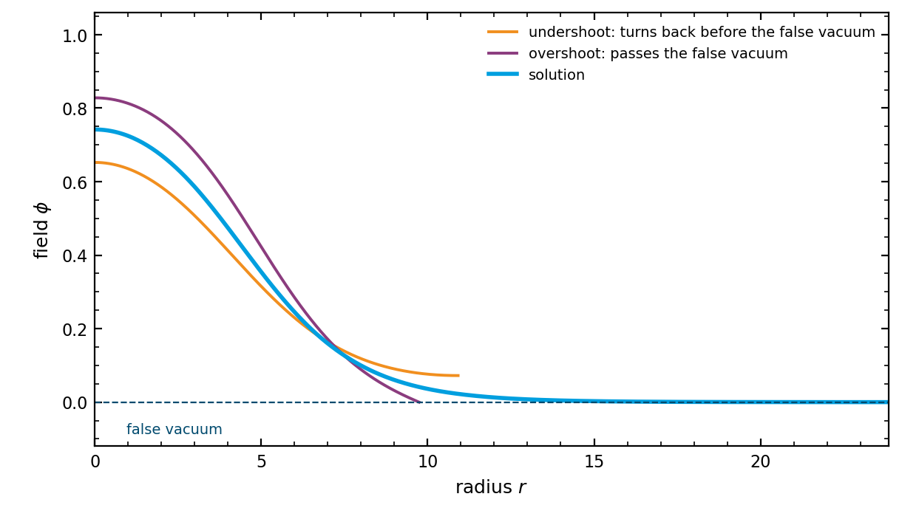
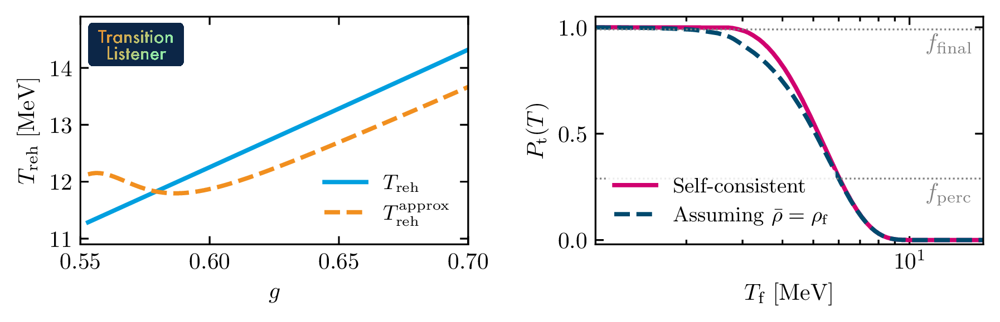
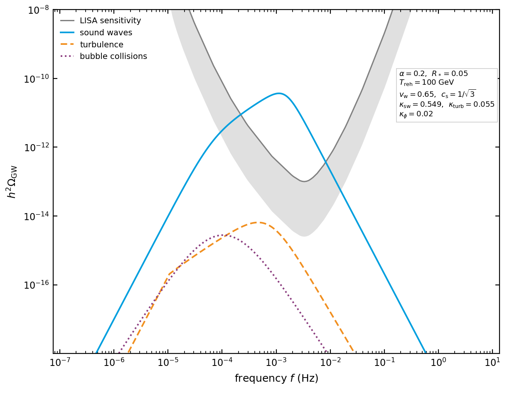

.. _features:

========
Features
========

TransitionListener computes the gravitational wave spectrum of a cosmological first-order
phase transition from a particle physics model, with every step in between: the effective
potential, the phases, the bounce, the nucleation history, the hydrodynamics and the signal.
You write down the model, and the package does the rest.

   A run goes from a model file to a signal-to-noise ratio in six steps.

Models
------

A model file specifies the tree-level potential, the field content and the field-dependent
mass spectrum. The values of its parameters are set in the configuration file of the run. The
one-loop corrections at zero and at finite temperature, the counterterms and the daisy
resummation are computed by the class that every model inherits from,
:py:mod:`transitionlistener.generic_potential`, so the model file carries the physics of the
model and not the machinery around it. Any number of scalar fields is supported. Four models
ship with the package, in eight model files: the two Higgs doublet model, a dark U(1) with a
dark photon and a dark Higgs, the conformal limit of that model with a dark fermion added,
and a dark sector of two singlet scalars that mix with each other.

   A barrier appearing as the universe cools, which is what makes a transition first order.

Strongly supercooled transitions
--------------------------------

Phases are traced in temperature and the candidate transitions between them are found
automatically. The bounce action is computed along a path through field space that is
deformed until it solves the equations of motion in every direction. The solvers are written
for transitions supercooled by orders of magnitude below the critical temperature, for actions
that are not monotonic in temperature, for expansion dominated by the vacuum energy, and for
scales from the MeV range to the scale of grand unification. Only the thermal, three
dimensional bounce is computed: a transition supercooled far enough that the four dimensional
action :math:`S_4` is the smaller exponent is outside what this version covers, as
:doc:`algorithms/the_bounce_action` states.

   Finding the bounce by overshooting and undershooting.

A self-consistent false vacuum evolution and Hubble expansion
-------------------------------------------------------------

The false-vacuum fraction, the expansion rate and the temperature of the plasma inside the
bubbles all depend on each other, and the package solves them together rather than one after
another. It reports the percolation, completion and reheating temperatures, the transition
strength, the mean bubble separation and both definitions of the inverse duration, with the
wall velocity in local thermal equilibrium.

   What the self-consistent treatment changes, from arXiv:2605.15259. Left: the reheating
   temperature :math:`T_\mathrm{reh}` of the conformal dark :math:`U(1)` model against its
   gauge coupling :math:`g`, computed from the energy the transition releases, against the
   approximation :math:`T_\mathrm{perc}(1+\alpha)^{1/4}` from the strength :math:`\alpha`
   alone. Right: the true-vacuum fraction :math:`P_\mathrm{t}(T_\mathrm{f})` of an ultraslow
   transition in the dark :math:`U(1)` model, solved together with the expansion (solid) and
   with the expansion rate taken from the false vacuum alone (dashed).

The two reheating temperatures differ by about ten per cent, and the spectrum is redshifted by
that temperature. In the right panel the percolation temperature moves little and the final
temperature :math:`T_\mathrm{f}` moves a great deal, so a transition that the approximation
reports as never completing does complete.

Every run also carries a row of warnings and diagnostics: whether the sound speed survived a
change of the differencing step, whether the two entropy schemes agree, whether the accuracy
targets were met, whether the wall velocity is a choice among branches. Nothing is silently
patched.

The gravitational wave signal and its detectability
---------------------------------------------------

The gravitational wave spectrum is built from the bubble collisions, the sound waves and the
turbulence, with the templates of the LISA Cosmology Working Group and efficiency factors
taken from the wall velocity and the strength. It is then compared against the sensitivities
of LIGO-Virgo-KAGRA, LISA, DECIGO, BBO, the Einstein Telescope, Cosmic Explorer and muAres,
and against the pulsar timing arrays, with likelihoods for the NANOGrav and IPTA data sets.

   The three sources of the spectrum, and the LISA sensitivity curve.

Scanning
--------

A run is configured by one file, the YAML file that ``tl -c`` is pointed at. Single points,
grids, lines, random scans and nested sampling with UltraNest all use the same format. A run
writes a table of its output, and the plots that :doc:`algorithms/the_plots` describes: the
potential, the traced phases, the action against temperature, the percolation history, the
bubble profile and the spectrum against the detectors. A scan writes one map of the grid per
output quantity.

At a glance
-----------

================================  ============================================================
Fields                            any number of scalars, with mixing
Resummation                       Arnold-Espinosa, Parwani, or none
Phase tracing                     adaptive in temperature, with the symmetry of the potential
Bounce                            path deformation in several field directions
Percolation                       two solvers, one adaptive and one on a fixed grid
Expansion history                 self-consistent, with reheating and a computed sound speed
Wall velocity                     local thermal equilibrium
Spectrum                          collisions, sound waves, turbulence
Detectors                         ground, space and pulsar timing
Scans                             point, grid, line, random, nested sampling
================================  ============================================================

Further reading
---------------

:doc:`getting_started` runs your first point. :doc:`usage` is the configuration file.
:doc:`algorithms/index` is what the package actually computes, stage by stage.
